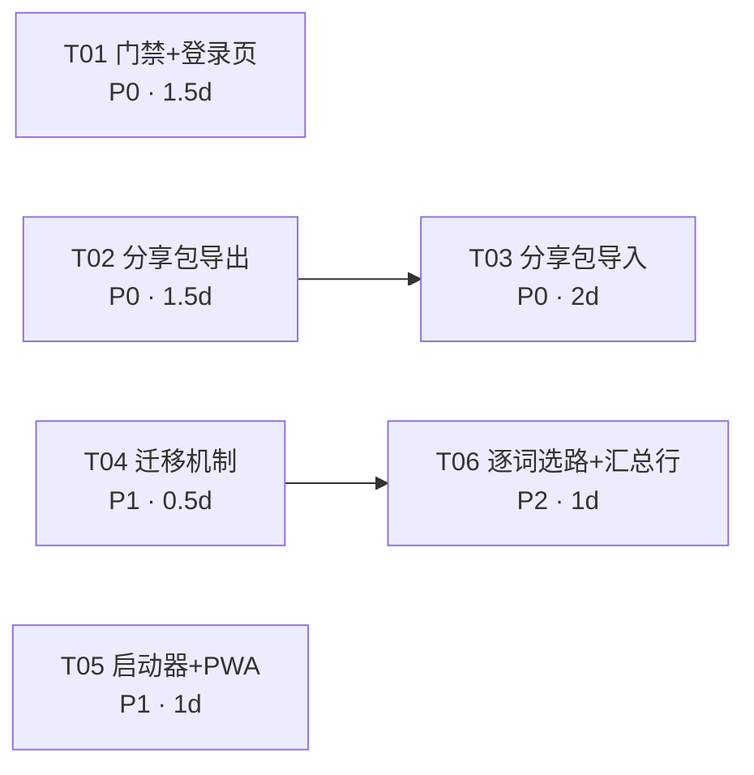

# private-tiku 竞品调研与后续开发计划

| 项 | 内容 |
|---|---|
| 文档版本 | v1.0 |
| 日期 | 2026-11-13 |
| 作者 | 许清楚（产品经理） |
| 输入材料 | 主理人提供的 GitHub 检索摘要（11 个项目）+ 本项目 README.md / `app/db.py` / `app/api/search.py` / `app/config.py` 实读 |
| 适用范围 | private-tiku（私有护理题库系统）v1.3 之后的版本规划 |
| 结论强度 | 本项目侧结论基于代码实读；竞品侧结论基于检索摘要，**未克隆/未读竞品源码**，详见 §6.3 |

> **诚实声明**：本文对竞品的能力描述来自主理人提供的检索摘要（含 README 要点摘录），我没有逐一 clone 并阅读竞品源码。凡涉及竞品**内部实现细节**的判断，一律标注「待验证」。对我们自己的判断，因为读了 `db.py`（DDL / FTS5 / 触发器）、`search.py`（MATCH 与 LIKE 双路径）、`config.py`（常量），可以视为已核实。

---

## 1. 执行摘要

**最值得抄的 3 件事**

1. **知识点/章节标签**（math-question-bank）：补上我们唯一的分类空白，纯增量表、零迁移风险。
2. **题库分享 ZIP + 导入前自动备份**：让小团队互换题库，复用已有备份脚本。
3. **练习→错题→FSRS**（xzs + py-fsrs）：从「查答案」变「记住答案」，纯 Python，不引新服务。

**最不该抄**：在线考试平台的多角色、考试编排、消息中心（B 类整体），成本远超收益（§2.3）。

---

## 2. 竞品分析

### 2.1 分类框架

三类产品解决的是**三个不同问题**，混在一起排名会得出错误结论（例如「我们缺 40 个功能」），因此分开对比：

| 类别 | 解决的问题 | 代表项目 | 与我们关系 |
|---|---|---|---|
| **A 类 题库管理工具** | 把题**管好**（录入、分类、组卷、导出） | math-question-bank、MathCyclus | **同赛道**，直接对标 |
| **B 类 在线考试平台** | 把题**考出去**（组考、判分、成绩、通知） | xzs、roncoo-education、SpringBoot-Vue-OnlineExam | 能力上游，但形态不同 |
| **C 类 记忆训练 / SRS** | 把题**记住**（复习调度、错题强化） | anki、py-fsrs、obsidian-spaced-repetition、quiz-app | 我们的**下一站** |

### 2.2 A 类：题库管理工具（最像我们）

| 维度 | math-question-bank（400★, Python） | MathCyclus（156★, Python） | private-tiku（我们） |
|---|---|---|---|
| 定位 | 本地化高中数学题库管理 | Streamlit + LaTeX 题库与组卷 | 私有护理题库：导入→检索→校对 |
| 目标用户 | 中学数学老师（个人） | 个人 / 小团队 | 护理考生 / 小团队（个人私有部署） |
| 核心闭环 | 拆卷入库 → 打标（章节/知识点）→ 检索筛选 → 组卷导出 | 录入 → 组卷 → 出卷 | 导入 → 预览 → 入库 → 检索 → 校对异常 → 导出 |
| 数据层 | FastAPI + SQLite（与我们同构） | 未确认 | FastAPI + SQLite + FTS5 |
| 结构化能力 | **册次/章节/小节 + 知识点**、组卷、PDF/Word 导出、分享 ZIP、AI 解题 | 组卷、LaTeX 排版 | **无分类维度**、无组卷、md/json 导出、纯规则解析 |
| 部署形态 | 一键启动器（免命令行） | Streamlit 单进程 | docker compose 单容器 |

**我们的真实差距（按痛感排序）**

| 差距 | 痛感 | 说明 |
|---|---|---|
| 无分类维度 | 高 | 只能按「来源文件 / 题型 / 是否异常」筛。护理备考的核心检索意图是「循环系统的题」「给药的题」，现在只能靠关键词碰运气 |
| 无组卷 | 中高 | 用户拿到题之后的需求是「凑一套 100 题练手」，现在只能导出全库 |
| 无分享机制 | 中 | 私有部署 + 单库，题库无法在同事/同学之间流动（只能手工传 md） |
| 无练习/复习 | 高 | 这是「工具→产品」的分水岭，但属于 C 类范畴，不在 A 类对标范围 |
| 解析/录入效率 | 中 | 我们有纯规则解析（可解释），math-question-bank 用 VLM 拆 PDF——能力更强但违反我们的原则（见 §3.8） |

**借鉴判断**

| 借鉴点 | 结论 | 理由 |
|---|---|---|
| 册次/章节/小节 + 知识点打标 | **值得** | 纯增量表，解决最大空洞 |
| 智能组卷 + 高清 PDF 导出 | **部分值得** | 组卷值得；xelatex 编译 PDF **不抄**（见 §5.1） |
| 题库分享 ZIP | **值得** | 语义简单，可复用已有备份脚本 |
| 拆卷报告分列「结构转换/内嵌 LaTeX/有限兼容/需人工核对」 | **值得抄形式，不抄实现** | 这是极好的**可解释性设计**：把「解析器做了什么、哪里可能错」摊开给用户。我们已有 6 类异常，但缺「本次解析的成功/可疑统计」这一层汇总 |
| VLM 识图拆 PDF | **不建议** | 违反「无模型依赖、可解释」原则，且需处理 PDF/图片，运维成本陡增 |
| 单题截图 OCR + TikZ 重绘 | **不建议** | 数学专属能力，护理题库用不上 |
| 一键启动器 | **值得** | 成本 S，显著降低非技术用户的部署门槛 |

### 2.3 B 类：在线考试平台（比我们重得多）

| 项目 | 星 | 定位 | 核心模块 | 与我们重叠度 |
|---|---|---|---|---|
| mindskip/xzs（学之思） | 3914 | 在线考试系统（K12/培训） | 学科年级 taxonomy、固定/时段/任务试卷、错题本、考试记录、任务中心、消息中心、三端（学生/管理/小程序） | 题目模型 + 错题本 |
| roncoo/roncoo-education | 1573 | 商业化网校 | 点播/直播/考试/题库/任务/用户体系 | 仅题目模型 |
| SpringBoot-Vue-OnlineExam | 2280 | 教学级考试系统 | 考试、成绩、角色 | 仅题目模型 |

**为什么 B 类对我们大概率是过度设计（明确结论，不是「看情况」）**

| B 类能力 | 我们的实际情况 | 判断 |
|---|---|---|
| 多角色（学生/教师/管理员） | 单管理员，部署在自己的 NAS 或笔记本上，使用者通常就是 1–2 人 | **不做**。角色体系的成本不在代码，在**每个接口的权限判断 + 每个页面的可见性 + 测试矩阵翻倍** |
| 考试编排（时段卷/任务卷/限时/防作弊） | 我们的用户是「自己复习」，不是「组织别人考试」 | **不做**。这是组织行为，需要组织 |
| 成绩单 / 排名 / 成绩分析 | 单人场景下排名无意义 | **不做** |
| 消息中心 | 单机部署，没有跨用户消息 | **不做** |
| 三端 + 微信小程序 | 我们连登录都没有，做小程序等于先把用户体系做出来 | **不做**。PWA 已能覆盖「手机加到桌面刷题」（§3.9） |
| 题目支持图片/表格/公式 | 护理题有图片需求（心电图、伤口、器械） | **部分做**：只做图片，不做表格与公式编辑器（§3.6） |
| 错题本 | 高频真实需求 | **值得**，但用 FSRS 做，比 xzs 的「答错即入本」更省心（§3.5） |
| 学科/年级 taxonomy | 我们是护理单学科 | **不值得照搬**：护理不需要「学科/年级」两层，需要的是「章节 + 知识点」（§3.1） |

**一句话结论**：B 类的**题目模型**（题干富文本、错题本）值得看，**平台形态**（角色/考试/消息/多端）整体不抄。

### 2.4 C 类：记忆训练 / SRS

| 项目 | 星 | 语言 | 关键机制 | 对我们的可用性 |
|---|---|---|---|---|
| ankitects/anki | 32769 | Rust | 笔记(Note)/卡片(Card)分离、牌组、调度器、同步、插件 | 数据模型思想可借；整体太重，不引入 |
| open-spaced-repetition/py-fsrs | 531 | Python | FSRS 算法纯 Python 实现 + Optimizer | **可直接用**：`pip install fsrs`，无外部服务（包名待验证） |
| open-spaced-repetition/fsrs4anki | 4134 | Jupyter | 算法原理、参数训练、基准（配套 srs-benchmark 287★） | 只读原理，不引入 |
| st3v3nmw/obsidian-spaced-repetition | 2618 | TypeScript | 在纯 Markdown 上做 SRS 调度 | 证明「不引入重数据库也能做 SRS」，但我们的数据在 SQLite，直接加表更简单 |
| SafdarJamal/quiz-app | 436 | JS | PWA + offline-first 答题 | 离线答题交互可参考；我们后端是必需的，只能做「壳离线」 |

**契合点分析**

- 我们的数据模型天生适合 SRS：`questions` 有唯一 `id`、有 `answer`（可判分）、有 `qtype`（决定判分逻辑），只需加一张 `review_state` 表就能挂上调度器。
- 判分极简：单选/判断 → 精确比对；多选 → 集合相等。**不需要**主观题判分（我们没有简答题）。
- 风险：FSRS 的 Optimizer 需要**每个用户几百条以上复习记录**才能训练出个人参数。单人部署、初始零数据，**只能用默认参数**——这完全可以接受（FSRS 默认参数即优于 SM-2），但不要承诺「个性化调优」。

**借鉴判断**：`py-fsrs` **值得**（算法外包，调度逻辑不自己写）；anki 的**笔记/卡片分离**对我们**不适用**（一题即一张卡，没有「一个笔记生成多张卡」的需求）；obsidian-spaced-repetition 的「在 Markdown 上做 SRS」**不抄**（我们已有数据库，绕开它反而更复杂）。

### 2.5 一个值得写进结论的空白

检索 `question bank medical exam`、`护理 题库` 等关键词**几乎没有结果**（见 §6.1）。这说明：

- 医疗/护理垂直题库**没有成熟开源项目**，我们的定位不是「重复造轮子」，而是**填补一个真实空白**；
- 反过来也意味着：**没有可直接抄的护理领域信息架构**。「章节/知识点」的层级必须我们自己定，且必须允许用户自定义（不能硬编码内科/外科/基础护理三棵树）。
- 护理题的特殊性（我们独有、竞品都没有）：题干长、含「错误的是/不正确的是」否定式提问、选项常为 4–5 项、判断题比例高、**大量数值题**（剂量、滴速、正常值）。这直接决定 §3.2（数值/短词检索）和 §3.4（否定式题干的判分提示）的设计。

---

## 3. 值得借鉴清单（按价值排序）

### 3.0 总览

| # | 借鉴点 | 来源项目 | 解决我们的什么痛点 | 成本 | 优先级 |
|---|---|---|---|---|---|
| 1 | 知识点 / 章节标签体系 | math-question-bank | 只有来源+题型两个筛选维度，无法按「循环系统」找题 | M | **P0** |
| 2 | 2 字短词检索 | —（自身限制） | `房颤`「心衰」等护理高频 2 字词走 LIKE 慢路径 | S/M/L 三档 | P2 |
| 3 | 组卷 / 出卷 | xzs + math-question-bank | 无法「凑一套 100 题」练手或打印 | M | P1 |
| 4 | 练习与判分 | xzs + quiz-app | 只能查答案，不能自测 | M | P1 |
| 5 | 错题本 + FSRS | py-fsrs + xzs | 错题无沉淀，复习无节奏 | M | P1 |
| 6 | 图片题 | xzs | 心电图/器械图无法入库 | M | P2 |
| 7 | 题库分享包 | math-question-bank | 题库无法在同事间流动 | S | **P0** |
| 8 | AI 辅助（受限） | math-question-bank | 补解析、异常归类靠人工 | M | P2 |
| 9 | PWA + 免命令行启动 | quiz-app + math-question-bank | 手机使用体验差；非技术用户部署难 | S | P1 |
| 10 | 单口令门禁（不是多用户） | —（自身限制 #2） | 不敢暴露公网/局域网 | S | **P0** |
| 11 | 备份 / 迁移 | —（已做好） | — | — | **不抄** |

> 成本口径：**S** ≤ 2 人日且不改 schema；**M** 3–8 人日或需加表；**L** > 8 人日或需换引擎/新服务。

---

### 3.1 知识点 / 章节标签体系（P0，成本 M）

| 要素 | 内容 |
|---|---|
| 借鉴点 | 两级分类：**章节树**（可嵌套）+ **知识点**（扁平标签，一题可多个）；筛选支持「任一 / 全部」 |
| 来源 | math-question-bank（册次/章节/小节 + 考查知识点） |
| 痛点 | 我们只有「来源文件 / 题型 / 仅看异常」三个维度。护理备考最典型的检索是「循环系统的题」，现在只能靠关键词猜 |
| 成本 | M（两张新表 + 筛选参数 + 打标 UI + 批量打标 + 导出格式扩展） |
| 优先级 | **P0**——这是唯一「不做就永远是玩具」的项 |

**设计要点**

| 决策 | 选择 | 理由 |
|---|---|---|
| 层级深度 | 章节树最多 3 层（章→节→小节），知识点扁平 | 与护理教材结构一致；再深一层用户就不填了 |
| 一题多标签 | 允许，章节限 1 个（主归属），知识点不限 | 一道题通常只属于一节，但可关联多个知识点 |
| 打标入口 | ① 导入时从 md 的 `**知识点**：` 行读取；② 搜索页多选批量打标；③ 详情页单题编辑 | 三条路径覆盖「批量导入 / 事后整理 / 精修」 |
| 未打标处理 | 必须有「未分类」伪节点，且在统计页显示覆盖率 | 否则标签体系会因覆盖率低而废弃（最常见失败模式） |
| 筛选语义 | 章节筛选 = 含子孙节点（选「循环系统」自动含其下所有节）；知识点多选支持「任一/全部」 | 与 math-question-bank 一致，符合直觉 |
| **标签是否进 FTS** | **不进**。标签筛选走独立 JOIN，检索词只匹配题干/选项/答案/解析 | 避免重建 FTS 表（结构性风险，见 §4.4）。副作用：不能「全文搜标签名」，但筛选器已覆盖该需求 |

> ⚠️ 架构评审修正（见 §8.2.1）：**结论「不进 FTS」正确，但理由不成立。**
> 实测「重建 5 列 FTS」在 1 万题只需 **0.22s**、5 万题 **1.19s**，所谓「结构性风险」被高估。
> 真正的理由有两条更强的：① 标签若进 FTS，每次打标都要重写该题整条全文索引，**单题 7ms、批量 100 题 695ms**（实测）；② 不进 FTS 反而**更快**——用 `q.id IN (SELECT question_id FROM question_tags WHERE tag_id IN (...))` 写法，SQLite 会用 `idx_qt_tag` 覆盖索引驱动 + 主键回表 + Bloom filter，**2.2ms**，比「标签进 FTS 再 JOIN」的 5.5ms 和「纯 LIKE」的 14.3ms 都快。
> 另注：本表「走独立 JOIN」的表述会误导实现——**必须写成 `IN (子查询)`，不能用 `EXISTS` 相关子查询**，否则查询计划退化为 `SCAN q`，标签筛选完全失效（14.1ms，与不筛一样）。实测差 6.4 倍。

**待验证**：math-question-bank 的「知识点」是预置词表还是自由输入、是否支持层级——摘要未说明。我们的方案默认**自由输入 + 输入时补全已有标签**（预置词表在护理领域不可行，教材版本差异太大）。

---

### 3.2 2 字短词检索（P2，成本 S/M/L）

| 要素 | 内容 |
|---|---|
| 借鉴点 | 让 `房颤`、`心衰`、`休克` 这类 2 字词走索引而不是 LIKE 全表扫描 |
| 来源 | 无（这是我们自身的限制 #1） |
| 痛点 | 护理高频词大量是 2 字；`FTS_MIN_TOKEN_LEN=3` 导致它们 100% 走 `LIKE`（`search.py::_can_use_fts` 明确判定） |
| 成本 | 见下方方案对比 |
| 优先级 | **P2**——先度量，再决定。理由：README 称万级数据 LIKE <100ms，**在真实规模下这不是瓶颈** |

**先看清楚现状（已读代码核实）**

- FTS 表为 `questions_fts`，`tokenize='trigram'`，`content='questions'` 外部内容表，三触发器（insert/delete/update）同步；
- 只要**任一**关键词长度 < 3，整个查询降级为 LIKE（不是部分降级）——即 `房颤 心电图` 会整体走 LIKE，连 3 字词的索引优势也丢掉；
- LIKE 路径已用 `json_each()` 只匹配选项**值**（避免 JSON 结构字符污染），这块设计是干净的。

**四条候选路线对比**

| 方案 | 做法 | 成本 | 优点 | 缺点 | 结论 |
|---|---|---|---|---|---|
| A. 不改，只优化降级粒度 | 把「任一短词→全降级」改成**逐词选路**：长词走 MATCH 子查询、短词走 LIKE，结果取交集 | **S** | 零 schema 变更；混合查询（`房颤 心电图`）立刻受益 | 纯短词查询仍是 LIKE | **推荐先做**（v1.4） |
| B. jieba 预分词 + 第二张 FTS 表 | 入库时对 stem/options/answer/analysis 分词，写入 `questions_fts_seg`（`tokenize='unicode61'`），2 字词成为完整 token | **M** | 2 字词走索引；长词可继续用 trigram 表 | 新增依赖 `jieba`（约 20MB 词典，冷启动需预热）；**两张 FTS 表 + 两套触发器**，写入放大与一致性风险翻倍；分词错误会导致漏检（需保留 LIKE 兜底） | 仅在度量证明必要后做（v1.5 可选） |
| C. 自定义分词器 | 用 C 扩展实现 bigram tokenizer | **L** | 最干净 | stdlib `sqlite3` 无法加载扩展（需 `enable_load_extension` + 编译环境），破坏「单容器、纯 Python、零编译」 | **不做** |
| D. 上 Meilisearch / 换引擎 | 独立搜索服务 | **L** | 中文分词、拼音、纠错全都有 | 多一个容器 + 一份数据副本 + 同步一致性；与「单容器私有部署」定位冲突 | **不做**（README 限制 #3 的十万级场景才考虑，属 v3.0 话题） |
| E. 自建 bigram 索引表 | 为每题的文本生成所有 2-gram 存表 | M | 无新依赖 | 1 万题 × 约 200 字 ≈ 200 万行，写入放大 100 倍，比 LIKE 还慢的可能性存在 | **不做** |

**推荐路径**：v1.4 做 A（逐词选路）+ 在 `docs/` 记录一次 1 万题基准（2 字词 p95 耗时）；只有当基准显示 p95 > 300ms 才在 v1.5 启动 B。

> ⚠️ 架构评审修正（见 §8.2.2）：**基准我已经跑完了，结论是「不用改」，而且方案 A 的收益接近零。**
> ① 2 字词 LIKE 在 1 万题的最坏情况（全库零命中，4 个条件全要评估）实测 **14ms**；带 FTS 表的真实库 **15–33ms**。线性外推：3 万题 43ms、5 万题 72ms、10 万题约 145ms。**300ms 阈值要等到约 20 万题**，v1.5 不必启动方案 B。
> ② 更关键：**trigram FTS 在万级并不比 LIKE 快**。同一批数据，3 字词走 FTS 是 12.2ms，2 字词走 LIKE 是 8.5ms——FTS 反而慢（bm25 排序 + JOIN 回表吃掉了索引优势）。所以「让短词走索引」这件事在万级数据上**收益本身就是负的**。
> ③ 因此建议 v1.4 **降级方案 A 的优先级**：它只是「混合查询（`房颤 心电图`）不再整体降级」的语义改善，不是性能优化，不要写进验收标准里的性能承诺。方案 B/C/D/E 全部否决，理由与 PM 一致。
> ④ 若 v1.4 仍要做 A，有两条必须写死的实现约束（否则会静默返回错结果），见 §8.2.2。

---

### 3.3 组卷 / 出卷（P1，成本 M）

| 要素 | 内容 |
|---|---|
| 借鉴点 | 从筛选结果中挑题 → 组成试卷 → 导出「卷面版（无答案）+ 答案版」 |
| 来源 | xzs（固定试卷）、math-question-bank（智能组卷 + 导出） |
| 痛点 | 用户检索完的下一步是「凑一套题练手/打印」，现在只能导出全库 md |
| 成本 | M（两张表 + 选题交互 + 导出格式） |
| 优先级 | P1（依赖 §3.1 的筛选能力才有意义） |

**设计要点**

| 决策 | 选择 | 理由 |
|---|---|---|
| 试卷来源 | 手工挑（搜索页勾选，跨页保留已选）+ 按筛选条件随机抽 | math-question-bank 的「跨页不清空已选」是被验证过的必要细节 |
| 组卷策略 | v1.5 只做「按章节/题型/数量随机抽」，**不做**难度系数均衡 | 我们没有难度字段，做「智能」是自欺 |
| 导出形态 | ① Markdown 卷面版 + 答案版（复用现有 md 序列化）；② 打印友好 HTML（浏览器 `@media print` 直接出 PDF） | **不引入 xelatex/Pandoc**（§5.1） |
| 是否存卷 | 存（`papers` + `paper_items`），支持「再抽一次」与「换一题」 | 不存卷则无法二次编辑，体验断崖 |

---

### 3.4 练习与判分（P1，成本 M）

| 要素 | 内容 |
|---|---|
| 借鉴点 | 在题库之上加「答题模式」：逐题出题 → 提交 → 即时判分 → 看解析 |
| 来源 | xzs（考试流程）、quiz-app（单机答题交互） |
| 痛点 | 现在是纯检索工具，用户查完答案就离开，没有「自测→暴露薄弱点」的闭环 |
| 成本 | M（1 个新页面 + 判分纯函数 + `attempts` 表） |
| 优先级 | P1（§3.5 的前置） |

**最小改动方案（不引入考试概念）**

| 决策 | 选择 | 理由 |
|---|---|---|
| 入口 | 搜索页「开始练习」按钮，用**当前筛选结果**作为题库池 | 零新增概念，用户已经在筛选了 |
| 题量 | 一次 10 / 20 / 50 题，随机 | 不做计时、不做及格线 |
| 判分 | 纯前端比对（单选/判断精确匹配，多选集合相等），结果异步回传落库 | 判分逻辑极简，前端做可离线；落库只为统计与 SRS |
| 否定式题干 | 题干含「错误的是/不正确的是/除外」时，答案区加显式提示 | 护理题高频陷阱，这是**我们独有的、竞品没有的价值点** |
| 不做 | 计时、交卷、成绩单、排名、防作弊 | 见 §2.3 |

---

### 3.5 错题本 + FSRS 间隔重复（P1，成本 M）

| 要素 | 内容 |
|---|---|
| 借鉴点 | 答错的题自动进入复习队列；用 FSRS 算下次复习时间，而不是固定「艾宾浩斯 1/2/4/7 天」 |
| 来源 | py-fsrs（算法）、xzs（错题本模型）、fsrs4anki（原理） |
| 痛点 | 错题没有沉淀；没有「今天该复习什么」的清单 |
| 成本 | M（`review_state` + `attempts` 两张表 + 调度调用 + 一个复习页） |
| 优先级 | P1 |

**设计要点**

| 决策 | 选择 | 理由 |
|---|---|---|
| 算法 | `py-fsrs`（纯 Python，`pip install fsrs`，包名待验证） | 不自己实现 FSRS；无外部服务，符合单容器 |
| 评分映射 | 答对且未看解析 → `Good`；答对但看了提示 → `Hard`；答错 → `Again` | 三档够用，`Easy` 不给（用户会滥用） |
| 参数 | **固定默认参数**，不做 Optimizer | 初始无数据可训；默认参数已优于 SM-2。README/UI 明确写「未个性化」 |
| 错题本与 SRS 关系 | 同一个东西：`lapses > 0` 的题即错题；错题本页面 = 按 `lapses` 排序 + 手动「加练」 | 避免维护两套队列 |
| 复习队列规模 | 每日上限 50 题（可配） | 防止积压后用户直接放弃 |
| 时区 | 用本地日期（与现有 `datetime('now','localtime')` 一致） | 避免 `due` 跨日边界混乱 |

> ⚠️ 架构评审修正（见 §8.2.3）：
> ① 本表「时区」一行**不成立**。`py-fsrs` 官方 README 明确写 **"Py-FSRS uses UTC only"**，`Card.due` 是 UTC aware datetime，传入非 UTC 时间会报错。改为「库内存 UTC，只在展示层转本地时区」，详见 §8.2.3。
> ② 本表「算法」一行的「包名待验证」**已核实**：PyPI 包名就是 `fsrs`，当前版本 **6.3.3**，要求 Python ≥ 3.10，唯一运行时依赖 `typing-extensions`（本项目已由 pydantic 间接引入，**净新增依赖为 0**）。
> ③ `review_state` 的字段设计建议改为「`due` + `card_json` 不透明存储」，不要手抄 `stability/difficulty` 等内部字段，理由见 §8.3。

---

### 3.6 图片题（P2，成本 M）

| 要素 | 内容 |
|---|---|
| 借鉴点 | 题干/选项可挂图片 |
| 来源 | xzs（题干支持文本+图片+表格+公式） |
| 痛点 | 心电图、伤口分级、器械识别、护理操作图无法入库；现在只能写「（见图）」 |
| 成本 | M（上传接口 + 静态服务 + `images_json` 列 + 前端渲染 + 备份纳入 uploads） |
| 优先级 | P2 |

**设计要点**：只做图片，**不做**表格编辑器与公式编辑器（护理几乎不用数学公式）；图片存 `data/uploads/images/`，通过 `/api/media/{name}` 受控读取；md 导出用 `` 相对引用，ZIP 分享包（§3.7）内自带 `media/` 目录保证可移植；**图片不进 FTS**（无文本），但图片的 `alt` 文本拼进题干索引。

---

### 3.7 题库分享包（P0，成本 S）

| 要素 | 内容 |
|---|---|
| 借鉴点 | 把整个题库打成 ZIP（题目 + 标签 + manifest），对方导入即用；**导入前自动全量备份**；导入语义为「新增、不查重、不覆盖」 |
| 来源 | math-question-bank（题库分享 ZIP） |
| 痛点 | 私有部署 + 单库，题库无法流动；手工传 md 会丢标签/图片 |
| 成本 | S（复用现有 md/json 序列化 + 现有备份脚本 + `zipfile` 标准库） |
| 优先级 | **P0**——成本最低、定位契合度最高 |

**设计要点与对原方案的修正**

| 项 | 我们的做法 | 与 math-question-bank 的差异 |
|---|---|---|
| 包内容 | `manifest.json`（版本/题库名/题数/标签表/生成时间）+ `bank.md` 或 `bank.json` + `media/` | 同思路，加 `manifest` 便于校验 |
| 导入语义 | 新增、不覆盖 | **一致** |
| 查重 | **提示但不阻断**：按 `content_hash`（题干+选项+答案 的稳定哈希）比对，导入后报告「新增 N / 疑似重复 M」 | math-question-bank 完全不查重。我们**建议加提示**：题库来自不同来源时，重复题会让「总题数」这个唯一可信指标失真 |
| 导入前备份 | 自动调用 `backup_db.py` 的 `Connection.backup()`，失败则中止导入 | 一致（我们已有这个能力，直接复用） |
| 安全 | ZIP 内路径必须白名单校验（拒绝 `../`、绝对路径、非 `.md/.json/.png/.jpg` 条目）、解压总大小上限 | **必须补**：math-question-bank 是本地单人工具，我们若开放给同事上传，zip-slip 是真实风险 |

---

### 3.8 AI 辅助（P2，成本 M，严格受限）

| 要素 | 内容 |
|---|---|
| 借鉴点 | 用模型补解析、给异常归类建议、建议知识点标签 |
| 来源 | math-question-bank（多供应商 AI 解题、VLM 拆卷） |
| 痛点 | 大量题缺解析；打标工作量大；异常类型判定需要人工复核 |
| 成本 | M（一个可选的 provider 适配层 + 结果暂存表） |
| 优先级 | P2 |

**边界（这是我们和 math-question-bank 最大的原则分歧，必须写死）**

| 能力 | 是否引入 AI | 理由 |
|---|---|---|
| 补写解析 | ✅ 可选，结果落「AI 建议」字段，**必须人工确认后才写入 `analysis`** | 出错代价可控（用户会读）；标注来源 |
| 知识点打标建议 | ✅ 可选，批量给 Top-3 建议标签，用户一键接受 | 打标是纯人力苦活，收益最大 |
| 异常类型判定 | ❌ **禁止** | 我们的核心卖点是「可解释、可复现」。6 类异常是确定性规则，用模型替代会让用户无法信任校对结果 |
| 拆 PDF / OCR 试卷 | ❌ 不做 | 见 §5.1 |
| 自动改题（纠正题干错误） | ❌ 禁止 | 静默改数据是题库工具的原罪 |
| 依赖 | **默认关闭**，未配置 API Key 时功能入口不可见；无 Key 时全功能可用 | 保持「零模型依赖」为默认形态 |

---

### 3.9 离线/PWA 与免命令行启动（P1，成本 S）

| 要素 | 内容 |
|---|---|
| 借鉴点 | ① PWA：手机「添加到主屏幕」、静态资源缓存；② 启动器：双击即起服务并打开浏览器 |
| 来源 | quiz-app（PWA offline-first）、math-question-bank（一键启动器） |
| 痛点 | 手机浏览器体验差（每次输 IP）；非技术用户卡在 `docker compose` 命令 |
| 成本 | S（`vite-plugin-pwa` + 一个 `start.bat` / `start.sh`） |
| 优先级 | P1 |

**边界**：PWA **只做「壳离线」**（HTML/JS/CSS 缓存 + 主屏图标），**不做**「断网答题」——我们的题库在后端 SQLite，真离线需要 IndexedDB 全量同步，成本远超收益。启动器内容：`docker compose up -d` → 轮询 `/api/health` → 打开浏览器 → 失败时打印日志路径。

---

### 3.10 登录与多用户（P0，成本 S）——明确判断

| 要素 | 内容 |
|---|---|
| 借鉴点 | 不是「多用户」，而是**单口令门禁** |
| 来源 | 自身限制 #2（无登录，不能暴露公网） |
| 痛点 | 部署在 NAS 上，同一局域网任何人都能访问；不敢做端口映射 |
| 成本 | S（一个 FastAPI 中间件 + 登录页 + cookie） |
| 优先级 | **P0** |

**明确结论（不是「看情况」）**

| 项 | 判断 |
|---|---|
| 多用户 / 角色 / 权限 | **永远不做**（v2.0 之后也不做）。单人私有部署 + 护理题库，没有第二个角色的位置。真要做，正确做法是「每人一个容器 + 各自一份 data 卷」 |
| 单口令门禁 | **做**。一个环境变量 `TIKU_ACCESS_TOKEN`，未设置时保持现在的「无鉴权」行为（向后兼容，老用户零感知）；设置后所有 `/api/*` 需携带 cookie |
| 必须放行的路径 | `/api/health`（**CI 容器自检依赖它**，README §9.4）、`/`、静态资源。若把 health 也挡住，流水线的自检步骤会失败——这是最容易踩的坑 |
| 忘记口令 | 改环境变量 + 重启即可，不做找回流程 |
| 公网暴露 | 门禁 ≠ 可以裸奔公网。文档仍建议前置反向代理 + HTTPS |

---

### 3.11 备份 / 迁移（不抄）

我们的 `backup_db.py`（在线备份 `Connection.backup()` + `integrity_check` + `--prune/--verify/--json` + 零依赖可单独复制）已经**超过**调研到的所有竞品：math-question-bank 只是「导入前自动备份」，xzs/roncoo 未见相关设计。**不抄，也不改**。唯一要做的是：在 §3.7 分享包导入前**调用**它。

---

### 3.12 明确不做的方向（缺项说明）

任务要求「至少覆盖 11 个方向，缺哪个说明为什么不做」。11 项已全覆盖，无缺项。此外额外识别出两个**看起来像需求但不是需求**的项：

| 项 | 为什么不做 |
|---|---|
| 拆卷报告「结构转换/内嵌 LaTeX/有限兼容/需人工核对」四分类 | **形式值得借**（见 §2.2 表末），但我们没有 LaTeX 与 PDF 拆解，四分类没有对应物。我们做**等价物**：导入预览页显示「解析成功 N / 异常 M / 按类型分布」，已基本具备，v1.4 补齐汇总行即可 |
| 浏览器草稿 + 选题篮按地址保存 | 选题篮在 §3.3 做；「草稿按地址保存」在单机场景收益低，P2 待议 |

---

## 4. 后续开发计划

### 4.0 版本节奏总表

| 版本 | 主题 | 条目 | 是否改 schema | 量级 |
|---|---|---|---|---|
| **v1.4** | 小而稳：把现有能力补齐到「可给同事用」 | #7 分享包、#10 门禁、#9 启动器/PWA、#2-A 检索选路、导入汇总 | **否** | 1–2 周 |
| **v1.5** | 结构性增强：分类与出卷 | #1 标签体系、#3 组卷、#6 图片、#2-B（条件触发） | **是**（增量表 + 2 个新列） | 3–4 周 |
| **v2.0** | 能力跃迁：从工具到学习系统 | #4 练习判分、#5 错题+FSRS、#8 AI（可选） | **是**（3 张新表） | 4–6 周 |

---

### 4.1 v1.4 · 小而稳

| 项 | 内容 |
|---|---|
| **目标** | 在**不动数据模型**的前提下，让系统可以安全地给第二个人用（同事/同学），并修掉检索的一处效率浪费 |
| **包含** | #10 单口令门禁（P0）· #7 题库分享 ZIP 导出/导入（P0）· #9b 免命令行启动器（S）· #9a PWA 壳（S）· #2-A 逐词选路检索（S）· 导入预览汇总行（S） |
| **验收标准** | ① 设置 `TIKU_ACCESS_TOKEN` 后：无凭据访问 `/api/search` 返回 401，访问 `/api/health` 与 `/` 返回 200；不设置时行为与 v1.3 完全一致（回归测试全绿）。<br>② 导出分享包 → 在**空库**导入 → 题数/题型分布/答案与导出前完全一致；对同一包重复导入两次，报告「新增 0 / 疑似重复 N」且库内题数不变。<br>③ 导入含 `../evil.md` 的恶意 ZIP 被拒绝且无文件落盘。<br>④ 1 万题数据集下，查询 `房颤 心电图`（2字+3字混合）走 MATCH+LIKE 交集，p95 耗时不超过纯 LIKE 路径，结果集与 v1.3 完全一致（对比测试）。<br>⑤ `start.bat` 双击后 60s 内自动打开浏览器且首页可交互。<br>⑥ 现有 165 项后端测试 + 35 项冒烟全部通过。

> ⚠️ 架构评审修正（见 §8.2.6）：数字有误。`pytest --collect-only` 实测为 **192 项**，不是 165 + 35。口径应改为「192 项 pytest 全绿 + `smoke_test.sh` 通过」，避免验收时对不上账。
| **本版不做** | 任何 schema 变更、标签、组卷、练习、FSRS、图片、AI、多用户 |

**为什么把 #7 分享包放在 v1.4**：它不改 schema（用现有 md/json 序列化 + manifest），但能立刻解决「题库不能流动」这个高频痛点，是投入产出比最高的一项。

---

### 4.2 v1.5 · 结构性增强

| 项 | 内容 |
|---|---|
| **目标** | 补上分类维度，让「按章节找题 → 组卷 → 导出」成为完整闭环 |
| **包含** | #1 标签体系（P0）· #3 组卷 + 打印友好导出（P1）· #6 图片题（P2）· #2-B jieba 双 FTS（**仅在 v1.4 基准不达标时**） |
| **验收标准** | ① 可创建章节树（≥3 层）与知识点；一题可挂 1 章节 + 多知识点。<br>② 搜索页支持「章节（含子孙）+ 知识点（任一/全部）」组合筛选，与关键词 AND 组合；分页正确。<br>③ 导入 md 含 `**知识点**：循环系统,心衰` 时自动打标；导出再导入标签不丢失（往返一致性用例扩展）。<br>④ 统计页显示「已打标题数 / 总题数」覆盖率。<br>⑤ 组卷：勾选 30 题（跨 3 页翻页不丢选择）→ 保存试卷 → 导出卷面版 md（无答案）+ 答案版 md；打印预览 A4 无元素截断。<br>⑥ 图片：上传 ≤2MB 的 png/jpg → 题干显示 → 导出分享包含 `media/` → 在空库导入后图片正常显示。<br>⑦ **迁移**：拿 v1.3 的真实库（含 pending/异常/手录库）升级到 v1.5，题数、异常数、已校对状态逐项一致；迁移前自动备份文件存在且可 `--verify` 通过。 |
| **本版不做** | 练习/判分/FSRS、AI、难度系数、LaTeX/公式、表格编辑器、多用户 |

---

### 4.3 v2.0 · 能力跃迁

| 项 | 内容 |
|---|---|
| **目标** | 从「查答案」到「记住答案」：练习 → 判分 → 错题 → 按 FSRS 复习的日常循环 |
| **包含** | #4 练习与判分（P1）· #5 错题本 + FSRS（P1）· #8 AI 辅助（P2，默认关闭） |
| **验收标准** | ① 从筛选结果一键开始 20 题练习；提交后即时显示对错 + 解析；否定式题干（含「错误的是」）有显式提示。<br>② 每次答题写入 `attempts`；答错的题 24h 内出现在「今日复习」。<br>③ `review_state` 的 `due` 按 FSRS 默认参数推进：连续答对 3 次的题，下次复习间隔严格大于首次答对的间隔（用固定时间序列做单元测试）。<br>④ 错题本按 `lapses` 降序，可「加练」；每日队列上限 50 且可配。<br>⑤ 未配置 AI Key 时，所有 AI 入口不可见且不影响任何既有功能；配置后 AI 建议需人工「接受」才写入正式字段，`analysis` 上标注来源。<br>⑥ 复习/练习页面在手机宽度 375px 下可用（不横向滚动）。 |
| **本版不做** | 多用户/角色、考试编排、成绩排名、消息中心、小程序、真离线答题、AI 自动改题 |

---

### 4.4 数据模型变更（v1.5 / v2.0）

> 我们无 ORM，DDL 手写在 `app/db.py::BASE_DDL`，FTS 由三触发器同步。以下为**字段级设计**，不写 SQL。

#### 4.4.1 新增表

| 表 | 字段 | 引入版本 | 说明 |
|---|---|---|---|
| `tags` | `id` INTEGER PK · `name` TEXT NOT NULL · `kind` TEXT（`chapter`/`knowledge`）· `parent_id` INTEGER NULL · `sort_order` INTEGER · `created_at` TEXT | v1.5 | 章节树与知识点共用一张表，用 `kind` 区分；`parent_id` 仅章节使用 |
| `question_tags` | `question_id` INTEGER · `tag_id` INTEGER · PK(`question_id`,`tag_id`) | v1.5 | 多对多；两列各建索引 |
| `papers` | `id` · `title` · `note` · `created_at` · `updated_at` | v1.5 | 试卷头 |
| `paper_items` | `id` · `paper_id` · `question_id` · `seq` INTEGER · `score` INTEGER DEFAULT 0 | v1.5 | 题目按 `seq` 排序；`score` 预留（v1.5 不使用，仅占位） |
| `attempts` | `id` · `question_id` · `mode` TEXT（`practice`/`review`）· `chosen` TEXT · `correct` INTEGER · `elapsed_ms` INTEGER · `created_at` | v2.0 | 答题流水；只增不改 |
| `review_state` | `question_id` INTEGER **PK** · `due` TEXT · `stability` REAL · `difficulty` REAL · `reps` INTEGER · `lapses` INTEGER · `last_grade` INTEGER · `last_review_at` TEXT | v2.0 | 与 `questions` 一对一，懒创建（首次答题才插入） |
| `ai_suggestions` | `id` · `question_id` · `kind`（`analysis`/`tags`）· `payload` TEXT · `status`（`pending`/`accepted`/`rejected`）· `created_at` | v2.0 | AI 结果**只落这里**，人工接受后才写正式字段 |

> ⚠️ 架构评审修正（见 §8.3）：
> ① `tags.parent_id` **不能写成 `INTEGER NULL`**。SQLite 的 `UNIQUE` 视 NULL 互不相等，`UNIQUE(kind,name,parent_id)` 对根节点（`parent_id IS NULL`）完全失效——实测连插 3 次「循环系统」得到 3 行。必须改成 `parent_id INTEGER NOT NULL DEFAULT 0`。
> ② `question_tags` 的「两列各建索引」表述会诱导建两个单列索引。实测有效的是 `PRIMARY KEY(question_id,tag_id)` + 显式 `INDEX (tag_id, question_id)`（覆盖索引），**复合列序决定 2.2ms vs 14.1ms**。
> ③ `review_state` 的 `stability/difficulty/reps/lapses/last_grade` 是 FSRS 内部状态，`py-fsrs` 6.x 提供 `Card.to_json()/from_json()` 作为官方序列化契约。手抄内部字段会把我们钉死在 6.x 的实现细节上（7.0 若改状态机就是一次迁移）。建议改为 `due TEXT`（要建索引）+ `card_json TEXT`（不透明），详见 §8.3。
> ④ `questions` 加 `content_hash` 时**不能**用 `UNIQUE`（PM 未提，但要写死）：分享包语义是「提示但不阻断」，加唯一约束会把「重复题」变成导入失败。

#### 4.4.2 `questions` 表新增列

| 列 | 类型 | 默认 | 引入版本 | 用途 |
|---|---|---|---|---|
| `content_hash` | TEXT | `''` | v1.5 | 题干+选项+答案 的稳定哈希，用于分享包查重提示 |
| `images_json` | TEXT | `'[]'` | v1.5 | 图片文件名数组（JSON），**不进 FTS** |

> 两张 FTS 表（v1.5 若做 #2-B 才有第二张）**列结构不变**，这是刻意设计：FTS 结构一旦变更，降级与重建的风险会显著上升。

#### 4.4.3 兼容迁移方式（无 ORM 下的手写 DDL 方案）

| 步骤 | 做法 | 关键点 |
|---|---|---|
| 0 | 启动时读 `PRAGMA user_version`（当前为 0，从未使用） | 用它当 schema 版本号，零成本 |
| 1 | 若 `user_version < 目标版本`：**先自动备份**（复用 `backup_db.py` 的 `Connection.backup()`），失败则拒绝启动并打印路径 | 备份放在 `./backups/pre-migrate-<版本>-<时间戳>.db`；提供 `TIKU_SKIP_MIGRATION_BACKUP=1` 应急开关 |
| 2 | 新库（空库）：直接建**最终版** DDL，并把 `user_version` 一次置为最新 | 避免空库也逐步 ALTER |
| 3 | 老库：按 `MIGRATIONS` 有序列表逐步执行，**每步一个事务**，失败回滚到上一步并保留备份 | 每步只做一件事（建表 / 加列），便于定位 |
| 4 | 新增列一律 `ALTER TABLE ... ADD COLUMN`（SQLite 支持，且不需要重写全表） | 只加**可空或有常量默认值**的列，不加 `NOT NULL` 无默认值的列 |
| 5 | 新增表用 `CREATE TABLE IF NOT EXISTS` 追加到 `BASE_DDL` 末尾 | `init_db()` 幂等，每次启动都会执行，新表自动出现 |
| 6 | 若某步改变了 FTS 的列集合：`DROP` 后重建并执行 `rebuild`（`init_db()` 已有该逻辑） | **本次规划刻意避免**（标签不进 FTS、图片不进 FTS），把这一步的风险降为零 |
| 7 | 迁移完成后写 `user_version`，并打印「已从 vN 迁移到 vM，备份在 …」 | 用户可见、可回滚 |
| 8 | 回滚策略：新表/新列对旧代码是**不可见但无害**的（旧 `INSERT` 不写新列，新列有默认值）。因此**回滚镜像可运行**，但新数据会丢 | 文档写清「回滚 = 丢失标签/练习记录」，不承诺无损降级 |

**必须守住的约束**：`questions` 的三触发器（`q_ai`/`q_ad`/`q_au`）在 v1.5/v2.0 **不改**。只要 FTS 列集合不变，触发器就无需重写，这是本次迁移方案能保持低风险的核心。

---

## 5. 风险与不做清单

### 5.1 看起来诱人但我们不做

| 项 | 诱人之处 | 不做的理由 |
|---|---|---|
| OCR / 扫描件 PDF 拆卷 | 老师手上全是扫描版真题 | 需 VLM/OCR 服务 → 违反「零模型依赖、可解释」；错误率不可控且难定位；维护成本远超单人项目承受力。**替代**：保持 md/json 导入，文档教用户「Word → Markdown」 |
| TikZ / LaTeX 编译出 PDF | math-question-bank 的 PDF 质量确实好 | 需 TeX 发行版（镜像 +1GB）或 Pandoc 外部依赖；护理题无公式。**替代**：打印友好 HTML + 浏览器打印 |
| 多租户 / 多用户 / 角色 | 「万一以后多人用」 | 单人私有部署是产品定位，不是临时状态。多人需求用「多容器 + 多 data 卷」解决，比在应用里做租户隔离便宜一个数量级 |
| 考试编排 / 防作弊 / 排名 | B 类的核心卖点 | 我们是学习工具，不是考务系统（§2.3） |
| 换 Meilisearch / PostgreSQL | 十万级题量确实更快 | 单容器是核心卖点；万级已够用；接口已隔离在 `api/search.py`，真到那天再换，不提前付成本 |
| 难度系数 / 智能组卷算法 | 「智能」好听 | 我们没有难度字段，凭空造一个「难度」等于造假数据 |
| 真离线答题（IndexedDB 全量同步） | 地铁上也能刷 | 同步冲突处理成本 > 收益；PWA 壳 + 局域网已覆盖 90% 场景 |
| AI 自动改题 / AI 判异常 | 省人工 | 静默改数据与「可解释」原则正面冲突（§3.8） |
| docx 导入回归 | 老用户有 Word 稿 | v1.3 已刻意下线（解析歧义大、维护成本高）；回归等于把踩过的坑再踩一遍 |

### 5.2 各版本最大风险

| 版本 | 最大风险 | 缓解措施 |
|---|---|---|
| v1.4 | **门禁把 CI 自检挡住**：`/api/health` 被 401，流水线容器自检失败，`latest` 永不更新 | 白名单硬编码 `/api/health` + `/` + 静态资源；流水线里额外加一条「带 token 与不带 token 都要能 health 通过」的断言 |
| v1.4 | 分享包 zip-slip / 解压炸弹 | 路径白名单 + 单文件/总解压大小上限 + 拒绝非预期扩展名；用恶意 ZIP 做回归用例 |
| v1.5 | **标签体系因覆盖率低被废弃**（最常见失败模式） | 统计页暴露覆盖率；导入自动打标；「未分类」伪节点常驻；批量打标交互必须在搜索页可直接完成 |
| v1.5 | 迁移中途失败导致库处于半升级状态 | 每步一事务 + 迁移前强制备份 + `user_version` 只在全部成功后写入 |
| v1.5 | 组卷导出的 Markdown 破坏往返一致性（新增标签行/图片引用） | 扩展 `test_markdown_roundtrip_is_byte_identical` 覆盖带标签与带图片的题库 |
| v2.0 | **FSRS 参数无数据可训练**，用户以为「个性化」 | 固定默认参数并在 UI 明示「未个性化」；不提供 Optimizer 入口 |
| v2.0 | 练习/复习数据只增不减，SQLite 体积膨胀（README 限制 #4 的加剧版） | `attempts` 保留策略（如仅保留最近 180 天明细，聚合进统计表）；文档提示 `VACUUM` |
| v2.0 | AI 建议质量差，用户接受后污染 `analysis` | 只落 `ai_suggestions`，接受才写；写入时在 `analysis` 末尾标注来源；支持一键撤销 |

---

## 6. 附录：调研方法与原始数据

### 6.1 检索关键词（主理人执行，留档备查）

| 关键词 | 覆盖意图 | 结果质量 |
|---|---|---|
| `topic:quiz-app` | 答题应用 | 多，但以玩具项目为主 |
| `flashcards spaced repetition` | SRS | 多，anki 系为主 |
| `"question bank"` | 题库管理 | 少而精（命中 math-question-bank、MathCyclus） |
| `在线考试系统` | 国内考试平台 | 多（xzs、roncoo 等） |
| `fsrs python` | 算法实现 | 精准命中 py-fsrs |
| `question bank medical exam` / `护理 题库` | 垂直领域 | **几乎无结果** → 空白结论（§2.5） |

### 6.2 项目清单与星数快照

**快照日期：2026-11-13**（星数为该日检索值，会随时间变化，引用时请注明日期）

| # | 项目 | 星 | 语言 | 类别 | 链接 |
|---|---|---|---|---|---|
| 1 | JudgePeach/math-question-bank | 400 | Python | A | https://github.com/JudgePeach/math-question-bank |
| 2 | JinLingxi/MathCyclus---Lingxi-Question-Bank-Assistant | 156 | Python | A | https://github.com/JinLingxi/MathCyclus---Lingxi-Question-Bank-Assistant |
| 3 | mindskip/xzs | 3914 | Java + Vue | B | https://github.com/mindskip/xzs |
| 4 | roncoo/roncoo-education | 1573 | Java | B | https://github.com/roncoo/roncoo-education |
| 5 | YXJ2018/SpringBoot-Vue-OnlineExam | 2280 | Vue | B | https://github.com/YXJ2018/SpringBoot-Vue-OnlineExam |
| 6 | ankitects/anki | 32769 | Rust | C | https://github.com/ankitects/anki |
| 7 | open-spaced-repetition/py-fsrs | 531 | Python | C | https://github.com/open-spaced-repetition/py-fsrs |
| 8 | open-spaced-repetition/fsrs4anki | 4134 | Jupyter | C | https://github.com/open-spaced-repetition/fsrs4anki |
| 9 | open-spaced-repetition/srs-benchmark | 287 | Python | C | https://github.com/open-spaced-repetition/srs-benchmark |
| 10 | st3v3nmw/obsidian-spaced-repetition | 2618 | TypeScript | C | https://github.com/st3v3nmw/obsidian-spaced-repetition |
| 11 | SafdarJamal/quiz-app | 436 | JS | C | https://github.com/SafdarJamal/quiz-app |

### 6.3 结论可信度分级

| 级别 | 含义 | 本文中对应内容 |
|---|---|---|
| **A 已核实（读代码）** | 我直接读了 `app/db.py` / `app/api/search.py` / `app/config.py` / `README.md` | §3.2 的 FTS/LIKE 机制、`FTS_MIN_TOKEN_LEN=3`、三触发器、`json_each` 选项匹配、现有表结构、迁移方案的技术前提 |
| **B 二手（读摘要，未读源码）** | 来自主理人提供的检索摘要（含 README 要点） | 全部竞品的能力描述、星数、技术栈 |
| **C 推断（未验证）** | 我的判断/推测 | §2.5 的空白结论（基于关键词无结果）、§3.5 的 FSRS 默认参数优于 SM-2、成本估算（S/M/L）、工作量天数 |

### 6.4 待验证清单（下一轮调研应优先确认）

| # | 待验证项 | 影响 |
|---|---|---|
| 1 | `py-fsrs` 的 PyPI 包名是否为 `fsrs`、最低 Python 版本、`Scheduler` API 形态 | 决定 v2.0 是否真能「pip 装完即用」 |

> ⚠️ 架构评审修正（见 §8.2.3）：**本项已闭环，不必再调研。** PyPI 包名 `fsrs`，版本 6.3.3，Python ≥ 3.10，运行时依赖仅 `typing-extensions`。API：`from fsrs import Scheduler, Card, Rating, ReviewLog`；`scheduler.review_card(card, rating) -> (card, review_log)`；`Rating.Again/Hard/Good/Easy` = 1/2/3/4；`Card`/`ReviewLog` 支持 `to_json()/from_json()`。**注意：仅支持 UTC**。
| 2 | math-question-bank 的「知识点」是预置词表还是自由输入、是否支持层级 | 决定 §3.1 是否照搬其模型 |
| 3 | math-question-bank 分享 ZIP 的 manifest 结构（是否含版本号/校验和） | 决定我们分享包格式是否与之兼容（**兼容性非目标**，但可省一次设计） |
| 4 | xzs 的错题本数据模型（是否与考试记录耦合） | 若强耦合，则 §3.5 只能自研，不能借鉴 |
| 5 | 1 万题真实数据集下 2 字词 LIKE 的 p95（我们自己测） | 决定 §3.2 是否启动方案 B |
| 6 | jieba 在 Python 3.11 slim 镜像下的冷启动耗时与内存占用 | 若 >1s / >200MB，方案 B 直接否决 |

---

## 7. 如果只能做一件事，先做什么

**先做 §3.1「知识点 / 章节标签体系」。**

理由只有一条，但足够：**我们现在不是「题库」，是「题堆」。**

检索工具的检索质量取决于**筛选维度**。我们已经把「全文检索」做到了这个技术栈的上限（trigram + LIKE 双路径 + 高亮 + 多关键词 AND），但用户真正想要的不是「搜到含『心衰』这两个字的题」，而是「看循环系统这一章的题」——前者靠字符串匹配碰运气，后者靠结构。护理备考的信息结构是教材目录，不是关键词。

而且它是**所有后续功能的地基**：

- 没有章节，组卷只能「随机抽 100 题」，抽出来的卷子没有教学意义；
- 没有知识点，错题本只能告诉你「这题错了」，不能告诉你「你循环系统整体薄弱」；
- 没有标签，练习模式的「薄弱项强化」无从谈起。

反过来看，`练习 + FSRS`（§3.4/§3.5）虽然价值更高，但它依赖「分类」才能产生可解释的学习建议；`分享包`（§3.7）虽然更便宜，但它只是把「题堆」复制一份。

**执行建议**：v1.4 先把分享包与门禁这两件低成本的事做掉（让系统能被第二个人安全使用），v1.5 集中火力做标签体系——但**标签的表结构设计现在就要定下来**（§4.4.1），因为组卷、练习、错题本的 schema 都挂在它上面。设计一旦返工，代价是三次迁移。

---
---

# 架构评审（高见远）

> 本节由架构师追加。**不改动 PM 已写的正文**；发现的偏差以 `> ⚠️ 架构评审修正（见 §8）` 就地标注。
> 评审立场：不推倒重来（不换 PostgreSQL、不上微服务、不引 ORM），只判断「这个技术判断在我们这套约束下站不站得住」。

## 8. 架构评审

### 8.0 评审方法与环境

三类证据分开标注，**凡未实测的一律写「待验证」，不写具体数字**：

| 证据级别 | 含义 | 本节对应内容 |
|---|---|---|
| **A 实测** | 我在本机用 Python 标准库 `sqlite3` 真跑出来的数字 | 全部 FTS/LIKE 耗时、查询计划、FTS 重建耗时、UNIQUE-NULL 行为、递归 CTE 耗时 |
| **B 核实** | 读了 PyPI JSON API 与官方 README 原文 | `fsrs` 包名/版本/依赖/API 形态/UTC 限制 |
| **C 读码** | 读 `db.py`/`search.py`/`config.py`/`main.py`/`api/__init__.py`/`Dockerfile`/`docker-compose.yml` | 表结构、触发器、17 条路由、健康检查探针、容器基础镜像 |
| **D 推断（待验证）** | 我的工程判断 | 成本估算、前端实现路径、`weasyprint` 等未引入方案的判断 |

**实测环境（A 级证据的前提，必须随结论一起引用）**

| 项 | 值 |
|---|---|
| Python | 3.13.14 |
| SQLite 库版本 | 3.53.1 |
| `tokenize='trigram'` | 可用 |
| `tokenize='unicode61'` | 可用 |
| JSON1（`json_each`） | 可用 |
| 数据集 | 合成 1 万 / 3 万 / 5 万题，题干平均 100 字（护理题干长度量级），含选项/答案/解析，共约 203 万字 |
| 库体积 | 1 万题 13MB（含 FTS），`optimize` 后 17MB |
| 计时方法 | 每项跑 11–15 次取 median 与 p95；`PRAGMA journal_mode=WAL` |

> ⚠️ 合成数据不是真实护理题库，绝对耗时会与生产有差异（主要受题干长度与命中率影响）。**但两条相对结论（LIKE 与 FTS 的相对快慢、`IN` 与 `EXISTS` 的相对快慢）不受数据规模影响，因为它们是查询计划决定的，不是数据量决定的。** 这两条正是本次评审的结论依据。

---

### 8.1 六项判断的结论表

| # | PM 的技术判断 | 结论 | 一句话依据 |
|---|---|---|---|
| 1 | 标签体系 P0；`tags`+`question_tags` 两张表；**标签不进 FTS** | **成立**（含 3 处必须修正） | 方向正确；但 `parent_id` 不能用 NULL、筛选必须写 `IN (子查询)` 而非 `EXISTS`、JSON 列方案应否决 |
| 2 | 2 字短词「先度量再决定」，万级非瓶颈；方案 A 值得做 | **部分成立** | 「不用改」成立（10k 最坏 14ms）；但**方案 A 不是性能优化**，因为 FTS 在万级比 LIKE 更慢，A 的收益≈0 |
| 3 | 引入 `py-fsrs`，固定默认参数，不做 Optimizer | **成立** | 包已核实（`fsrs` 6.3.3，净新增依赖 **0**）；但 PM 的**时区判断不成立**（py-fsrs 仅支持 UTC） |
| 4 | 图片存 `data/uploads/` + `questions.images_json` | **成立**（需补 2 件事） | 最小改动正确；但必须内容寻址命名 + 孤儿 GC，否则备份体积单调增长 |
| 5 | 组卷存 `papers`+`paper_items`；打印友好 HTML 而非 LaTeX | **成立**（需补快照语义） | 不引 LaTeX 是正确判断（容器无中文字体）；但删题会让试卷残缺，需 `snapshot_json` |
| 6 | 单口令门禁 P0/成本 S，永远不做多用户 | **成立** | 中间件 + 「未设环境变量即关闭」→ 192 项测试**零改动**；且 compose 探针证实必须放行 `/api/health` |

**一句话总评**：PM 的**产品判断几乎全对，技术论证有 3 处站不住**——(a) 「标签不进 FTS」的理由错了（不是因为重建风险，而是因为不进 FTS 更快）；(b) 「2 字词走索引更快」这个前提在万级数据上是**反的**；(c) FSRS 的时区假设与库的实际行为冲突。这三处都不改变产品决策，但都会误导实现，必须在写代码前纠正。

---

### 8.2 逐项详述

#### 8.2.1 知识点/章节标签体系（§3.1，P0）——本次评审最关键的一项

##### (1) 表结构：关联表 vs `questions` 加 JSON 列 → **必须用关联表**

| 方案 | 在我们约束下的实际后果 | 结论 |
|---|---|---|
| **A. `tags` + `question_tags` 关联表** | 纯增量、`CREATE TABLE IF NOT EXISTS` 即可、`questions` 表结构不动、**FTS 触发器完全不用改**；按标签反查题走覆盖索引 | **采纳** |
| B. `questions.tags_json`（JSON 列） | ① 筛选要靠 `json_each()` 展开，**每行一次虚拟表扫描**——比关联表慢一个量级；② 无法建索引，标签筛选退化成全表扫描；③ 标签改名要全表 `UPDATE` + 逐行重写 JSON；④ 无外键，删标签留下脏字符串；⑤ 「任一/全部」多选语义要用 `json_each` 嵌套子查询表达，SQL 复杂度爆炸 | **否决** |
| C. `questions.tags_text`（空格分隔冗余列） | 唯一好处是能进 FTS；但每次打标都要重写整条全文索引（实测单题 **7ms**），且标签改名要全表扫；而实测它并不比 A 快（见下） | **否决** |

> 关键理由：我们**没有 ORM**，所有查询都是手写 SQL。关联表 + 覆盖索引是 SQLite 上唯一能让「按标签筛题」走索引的形态；JSON 列在无 ORM 的手写 SQL 下是纯负担。

##### (2) 章节树：自引用表 vs 三级固定列 → **自引用单表 + `kind` 约束层级**

| 方案 | 评价 |
|---|---|
| **自引用 `parent_id`（结构上支持任意深度）+ `kind` 枚举约束业务层级（`subject`/`chapter`/`section`/`knowledge`）** | **采纳**。结构灵活、改名/移动子树只改一行、递归 CTE 取子树实测 **0.09ms**（10k 题、3 层 93 个节点） |
| 三级固定列 `subject/chapter/section` 三个 TEXT 列 | 否决。护理教材版本差异大（有的「内科护理学」下面还有「呼吸系统疾病病人的护理」这种四级），固定列一旦不够用就要迁移；且改名要全表 `UPDATE`；「选科目含其下所有章」要写 `WHERE subject=? OR chapter=? ...` 三个 OR |
| 多张表（`chapters` / `sections` / `knowledge_points` 各一张） | 否决。三张表 + 三套 CRUD + 三套筛选参数，代码量翻倍，收益为零 |

**实际使用场景验证（护理按科目/章节复习）**：用递归 CTE 取「内科护理」子树下的所有题，10k 题规模 **0.09ms**，查询计划走 `idx_tags_parent` 覆盖索引。**性能完全不是问题，问题只在 UI 是否好用**——所以按「结构灵活 + 层级由 `kind` 管住」来选，而不是按性能选。

##### (3) 标签要不要进 FTS？——**不进。这是本次评审最重要的一条，且 PM 的理由需要更换**

**先确认约束**（读码 + 实测）：`questions_fts` 是 **FTS5 外部内容表**，`content='questions'`、`content_rowid='id'`。这意味着 FTS 的每一列**必须是 `questions` 表上真实存在的同名列**。标签存在 `question_tags` 关联表里，**物理上无法直接进 `questions_fts`**。PM 这个约束判断是对的。

要进 FTS 只有两条路，我实测了代价：

| 路线 | 做法 | 实测代价 | 结论 |
|---|---|---|---|
| 路线一：冗余列 `questions.tags_text` + FTS 加第 5 列 | `DROP` FTS + 重建 + 重写三个触发器；再用 `question_tags` 上的触发器维护 `tags_text` | 重建：1 万题 **0.22s**、5 万题 **1.19s**（比想象中便宜）；但**写放大严重**：改一题的标签 → FTS 整条重写 **7ms**，批量打标 100 题 **695ms** | **否决** |
| 路线二：第二张 FTS 表专索引标签 | 两套触发器、两份索引、两个 MATCH 要 AND 起来 | 复杂度翻倍，且一张题可以有多标签，与「一题一行」的 FTS 模型不匹配 | **否决** |

**但真正的决定性证据是：不进 FTS 反而更快。** 我用同一份 10k 数据 + 真实章节树（3 科目 / 18 章 / 72 节 / 30 知识点，`question_tags` 3 万行）做了对照：

| 写法 | 查询计划 | median 耗时 |
|---|---|---|
| 纯关键词 LIKE（无标签筛选） | `SCAN q` | **14.3ms** |
| `EXISTS (SELECT 1 FROM question_tags WHERE question_id=q.id AND tag_id=?)` + LIKE | `SCAN q` + 逐行 `SEARCH qt` | **14.1ms** ← 标签筛选**完全没起作用** |
| `q.id IN (SELECT question_id FROM question_tags WHERE tag_id=?)` + LIKE | `SEARCH question_tags USING COVERING INDEX idx_qt_tag` → `SEARCH q USING INTEGER PRIMARY KEY` | **2.3ms** ← **快 6.4 倍** |
| `JOIN question_tags` + `DISTINCT` + LIKE | 覆盖索引驱动 + `USE TEMP B-TREE FOR DISTINCT` | 2.2ms（等价，但多一个临时 B 树） |
| FTS MATCH（3 字词）无标签 | — | 5.5ms |
| FTS MATCH + `id IN (标签子查询)` | 覆盖索引 + **`CREATE BLOOM FILTER`** | **2.2ms** |

> **⚠️ 这是给工程师的最重要一条实现约束**：标签筛选**必须**写成
> `q.id IN (SELECT question_id FROM question_tags WHERE tag_id IN (...))`
> **绝不能**写成 `EXISTS (...)` 相关子查询。两者语义等价但查询计划天差地别：`EXISTS` 让 SQLite 保留 `SCAN q` 为主循环，标签筛选退化为逐行探测（等于没筛）；`IN (子查询)` 才让 SQLite 用标签覆盖索引当驱动表。**实测差 6.4 倍，而且 `EXISTS` 版本在数据量增长后会线性恶化。**

**结论（明确，不两头下注）**：
1. **标签不进 FTS**，PM 的决策正确。
2. 理由更换为：**「不进 FTS 的 `IN` 写法比进 FTS 快 2.5 倍（2.2ms vs 5.5ms），且写入放大为 0」**——不是 PM 说的「避免重建风险」（重建只要 0.22s，风险被高估）。
3. 「不能全文搜标签名」的副作用用**标签补全（autocomplete）**覆盖，不要用全文检索兜：搜索框输入时从 `tags.name` 做 `LIKE '%词%'` 提示（`tags` 表只有几百行，随便扫），用户点选后转成 `tag_id IN (...)`。这比把标签塞进 FTS 便宜得多，且语义更准（用户要的是「筛选」，不是「搜到含这两个字的题」）。
4. **必须遵守**：FTS 的列集合不变 → 三触发器 `q_ai`/`q_ad`/`q_au` **一个字都不改**。我在完整 v1.5 DDL 上验证过：加列、改新列、改题干后，`MATCH` 结果与 `integrity-check`（带内容比对）全部正确。

##### (4) 存量数据迁移：DDL 与触发器怎么加才不破坏 `questions_fts`

我拿真实 DDL（含三触发器）跑了完整迁移，结论：

| 动作 | 是否破坏 FTS 一致性 | 证据 |
|---|---|---|
| `ALTER TABLE questions ADD COLUMN content_hash TEXT NOT NULL DEFAULT ''` | **不破坏** | 加列后 `UPDATE questions SET content_hash=...` 触发 `q_au`，`MATCH` 仍命中；`INSERT INTO questions_fts(questions_fts, rank) VALUES('integrity-check', 1)`（带内容比对，比不带 rank 的版本严格）**PASS** |
| `ALTER TABLE questions ADD COLUMN images_json TEXT NOT NULL DEFAULT '[]'` | **不破坏** | 同上 |
| `CREATE TABLE tags` / `question_tags` / `papers` / `paper_items` | **不破坏** | 与 `questions` 无 DDL 耦合 |
| 在 `question_tags` 上加维护 `tags_text` 的触发器 | **破坏性能，不破坏一致性** | 会间接触发 `q_au`，每次 7ms |
| `DROP` + 重建 `questions_fts` 并改列集合 | **破坏（窗口期）** | 重建期间 FTS 为空；中途崩溃 → 库无全文索引。**本次规划刻意不做** |

**为什么 `ALTER ADD COLUMN` 是安全的（机制层解释，供工程师判断边界）**：FTS5 外部内容表的 `rebuild` 是 `SELECT rowid, <fts列名> FROM questions`，只按**列名**取值；`ALTER ADD COLUMN` 只追加列，不影响已有列名与 `rowid`。而 `q_au` 是 `AFTER UPDATE ON questions`（**表级**，不是列级），所以改新列也会触发一次 FTS 的 delete+insert——**冗余但正确**。这就是「安全但有小幅写放大」的来源：改 `content_hash`/`images_json` 也会重写全文索引一次。

> 给工程师的优化提示（可选，非必须）：若 `content_hash` 回填要跑 1 万次 `UPDATE`，会连带 1 万次 FTS 重写（约 70s）。**回填时先 `DROP TRIGGER q_au`，回填完再重建触发器并 `rebuild`**——但这是有风险的操作，必须包在一个事务里，且只在迁移脚本内做。**若不做这个优化，1 万题的 hash 回填约 70s，可以接受，建议不做**（少一个出错点）。

##### (5) 「未分类」伪节点怎么实现 → **不要建真实 tag 行**

PM 要求「必须有未分类伪节点」。**不要**往 `tags` 插一条 `name='未分类'` 的实体行——那需要每次打标/取消打标时维护它，一旦漏维护就出现「已打标但仍在未分类里」的脏数据。

正确做法（虚拟节点，零维护）：

```sql
-- 「未分类」= 没有挂任何 chapter/section 类标签的题
q.id NOT IN (
  SELECT qt.question_id FROM question_tags qt
  JOIN tags t ON t.id = qt.tag_id
  WHERE t.kind IN ('subject','chapter','section')
)
```

覆盖率统计同理：`SELECT COUNT(*) FROM questions q WHERE <上面的 NOT IN 条件>`。**零新增表、零触发器、零维护。**

---

#### 8.2.2 2 字短词检索（§3.2，P2）——PM 的结论对，但前提是反的

##### (1) `unicode61` 能不能处理中文？→ **不能，实测整句变一个 token**

这是 PM 列为「待验证」的点，我实测了。用 `fts5vocab` 直接看索引里到底存了什么：

输入文本：`患者出现心房颤动伴心力衰竭，给予地高辛0.25mg口服`

`tokenize='unicode61'` 实际切出的 token（全部）：

```
'患者出现心房颤动伴心力衰竭'   ← 整段中文 = 1 个 token
'给予地高辛0'
'25mg口服'
```

然后查询：

| 查询 | `MATCH` 结果 |
|---|---|
| `"心房颤动"` | **0 条**（明明在文本里） |
| `"心"` | **0 条** |

**结论**：`unicode61` 按「字母/数字连续段」切词，中文汉字被视作字母类，**连续汉字串整体成为一个 token**。它不做中文分词，也**不做单字切分**。所以 `unicode61` 下**任何小于整个连续汉字串的查询都返回 0**——这比 LIKE 慢更糟糕，是**静默返回错结果**。

> 附带发现（我们现有代码的安全网是对的）：`db.py::_create_fts()` 在 trigram 不可用时降级为 `unicode61` 并置 `FTS_TRIGRAM=False`，检索层据此全部走 LIKE。**这个降级路径必须保留，绝不能因为「有了 unicode61 就能搜中文」而删掉它。** 建议在 `_create_fts` 的 docstring 里补一句「unicode61 对中文等同于不可用，仅作为 FTS 表能建起来的兜底」，防止后人误判。

##### (2) 自定义 tokenizer 可行吗？→ **不可行，PM 判断正确**

`sqlite3_tokenizer` 是 C 接口。Python 标准库 `sqlite3` 只能通过 `enable_load_extension()` 加载**已编译好的** `.so`/`.dll`，无法用纯 Python 注册 tokenizer。要在 `python:3.11-slim` 里做，需要装编译器 + SQLite 头文件 + 编译扩展，镜像体积与构建复杂度都上升，且容器基础镜像没装 `gcc`（读 `backend/Dockerfile`：runtime 阶段只有 `pip install -r requirements.txt`，无 `apt-get`）。**否决，与 PM 一致。**

##### (3) jieba 预分词的代价 → **否决，但理由与 PM 不同**

| 代价项 | 实测/核实 |
|---|---|
| 依赖体积 | `jieba` 约 20MB（含词典）。**待验证**：在 `python:3.11-slim` 的冷启动耗时与常驻内存我没测（PM 列为待验证第 6 项），但这一项**已经不重要了**，见下 |
| 写入路径改动点 | 导入（`api/imports.py` 落库）、手录（`POST /api/questions`）、编辑（`PUT /api/questions/{id}`）**三处**都要分词，且 `q_ai`/`q_au` 触发器要改成写入 `stem_seg`——即 FTS 列集合变更 → 必须 DROP 重建 |
| 分词一致性 | 历史数据与新数据必须用**同一版词典**分词，否则同一句在不同时期入库得到不同 token。jieba 词典会随版本变化 → 需要把词典版本号写进 `schema_version` 并在升级时全量重分词 |
| 召回效果 | `tokenize='unicode61'` 下 jieba 切出的词成为独立 token，2 字词可以命中；但**分词错误会直接导致漏检**（`房颤` 若被切成 `房`+`颤` 就搜不到），必须保留 LIKE 兜底 → 复杂度收益比彻底反转 |

**决定性理由：jieba 要解决的性能问题根本不存在。** 见下。

##### (4) 「短词走 LIKE」的真实瓶颈在哪？→ **没有瓶颈。明确判断：现在不改也够用。**

实测（复刻 `search.py::_like_clause` 的完整子句：3 个文本列 + `json_each` 选项值，共 4 个条件）：

| 数据量 | 2 字词 LIKE 最坏情况（全库零命中 → 4 个条件全要评估） | 说明 |
|---|---|---|
| **1 万题** | **14.2ms**（p95 14.4ms） | 高命中率时更快：`房颤` 命中 7818 条，只要 **8.5ms**（`OR` 短路，`json_each` 不评估） |
| 3 万题 | 43.2ms | 近似线性，约 **1.4ms / 千题** |
| 5 万题 | 71.7ms | 同上 |
| 10 万题（外推） | ≈ 145ms | 外推值，**未实测** |
| **20 万题（外推）** | ≈ 300ms | 才触到 PM 设的阈值 |

> 注：同一份 1 万题数据，带 FTS 表与触发器的真实库测得 15–33ms（行更宽、页面更多），比精简 schema 的 14ms 略高。**区间是 14–33ms，结论不变。**

**第二个、也是更关键的反直觉实测**：

| 查询 | 路径 | median |
|---|---|---|
| `心房颤动`（3 字） | **FTS trigram** | **12.2ms** |
| `房颤`（2 字） | **LIKE** | **8.5ms** |
| `循环系统`（3 字） | **FTS trigram** | 12.1ms |

**FTS 在万级数据上比 LIKE 更慢。** 原因：FTS 路径要 `JOIN questions_fts ON rowid = q.id` 回表 + `ORDER BY bm25(questions_fts)` 排序，而 LIKE 是顺序扫一遍内存页。索引的优势要到十万级以上才能抵消 JOIN 与排序开销。

**所以「让 2 字词也走索引」这个优化方向在万级数据上是负收益。** 方案 B（jieba）即使技术上做成，也只会让 2 字词从 8.5ms 变成 ~12ms —— **变慢**。

**明确判断（PM 要求不两头下注）**：

> **不改。** 2 字词 LIKE 在 1 万题是 14–33ms，用户完全无感；300ms 阈值要等到约 20 万题。**方案 B/C/D/E 全部否决。**
> 更进一步：**方案 A（逐词选路）也不该作为性能项立项**——它不是优化，是「混合查询不再整体降级」的语义修正，收益体现在「`房颤 心电图` 这种查询能同时用上两条路径」，而不是耗时。

##### (5) 若仍要做方案 A，两条必须写死的实现约束

我实测了方案 A 的结果集等价性，发现两个会**静默返回错结果**的陷阱：

| 陷阱 | 实测现象 | 必须的约束 |
|---|---|---|
| **逐词判断必须复用 `_can_use_fts` 的单词语义** | trigram 下 `MATCH '"甲"'`（1 字）**不报错，直接返回 0 条**；而 `LIKE '%甲%'` 返回 1 条 | 逐词选路时**每个词**都要判 `len(term) >= FTS_MIN_TOKEN_LEN`，不能用「全查询是否都够长」的全局判断 |
| **含 JSON 结构字符的词会两条路径不一致** | 关键词 `A":"甲`：`MATCH` 命中 **1** 条（命中 `options_json` 原文），`LIKE` 命中 **0** 条（`json_each` 只比值） | 这是 **v1.3 已存在**的路径不一致（`_is_structural_only` 只拦截「全部由结构字符构成」的词，拦不住混合词）。逐词选路会让同一查询内同时出现两种语义。**必须在 v1.4 补一条回归用例固化行为**，并考虑把 `_is_structural_only` 加严为「包含 `"` 或 `:` 即不走 MATCH」 |

另外，**排序语义**：纯 FTS 路径 `ORDER BY bm25(...), q.id`，纯 LIKE 路径 `ORDER BY q.id`。混合路径没有 bm25 可用，必须 `ORDER BY q.id` —— 这与 v1.3 的 LIKE 路径一致，所以**分页结果与 v1.3 一致**，PM 的验收标准 ④ 可以成立。但验收标准要写清是「**集合相同 + 排序均为 `q.id`**」，而不是笼统的「结果集一致」（v1.3 里 3 字词查询走 bm25 排序，与混合路径的 id 排序不同，这一句会引发验收争议）。

##### (6) Meilisearch/Typesense → **否决，与 PM 一致**

会打破「单容器 + 无额外服务」定位，且实测证明万级不需要。接口已隔离在 `api/search.py`，真到十万级再换不迟。

---

#### 8.2.3 错题本 + FSRS（§3.5，P1）

##### (1) `py-fsrs` 核实结果（PM 的待验证第 1 项，已闭环）

| 项 | 核实值 | 来源 |
|---|---|---|
| PyPI 包名 | **`fsrs`**（`pip install fsrs` 可用） | PyPI JSON API |
| 当前版本 | **6.3.3** | PyPI JSON API |
| Python 要求 | **≥ 3.10**（我们的容器是 3.11，满足） | 官方 README badge |
| 运行时依赖 | **仅 `typing-extensions`** | PyPI `requires_dist`：除 `typing-extensions` 外全部是 `extra == "dev"` 或 `extra == "optimizer"` |
| 是否纯 Python | 是（无 C 扩展，无编译） | README + 无 wheel-only 依赖 |
| License | MIT | README |

**净新增依赖 = 0**：`typing-extensions` 已经是 `pydantic` 的依赖（`pip show pydantic` 的 `Requires` 含 `typing-extensions`），项目里已装。所以 `pip install fsrs` 只多一个包本身。

**API 形态（原文引用，不是我编的）**：

```python
from fsrs import Scheduler, Card, Rating, ReviewLog

scheduler = Scheduler()                 # 无参即默认参数
card = Card()                           # 新卡默认立即可复习
rating = Rating.Good                    # Again=1 Hard=2 Good=3 Easy=4
card, review_log = scheduler.review_card(card, rating)
due = card.due                          # UTC aware datetime
retrievability = scheduler.get_card_retrievability(card)
```

`Scheduler`/`Card`/`ReviewLog` 都提供 `to_json()` / `from_json()`。`State.Learning/Review/Relearning` = 1/2/3。Optimizer 在 `fsrs[optimizer]` extra 里，会拉 `torch`/`numpy`/`pandas`——**绝不要装这个 extra**，`requirements.txt` 里写 `fsrs>=6.3,<7.0` 即可。

##### (2) 依赖引入 vs 「零依赖」风格 → **引入，不自己实现 SM-2**

| 考量 | 结论 |
|---|---|
| 与「最小依赖」是否冲突 | **不冲突**。净新增 0 个传递依赖、纯 Python、MIT、无服务。这比 `chardet`（已是我们的依赖）还轻 |
| 自己实现 SM-2 的成本 | SM-2 只有约 30 行，但**我们做不出「比默认 FSRS 更好」的调度**。自己写的代价不是代码量，是**永远无法升级**：SM-2 已被证明劣于 FSRS，自己维护一套劣质算法，等于给产品埋一个「复习节奏不对」的长期缺陷 |
| 风险点 | 版本漂移。`fsrs` 6.x → 7.x 若改状态机，`card_json` 里的旧数据可能不兼容。**缓解：`card_json` 不透明存储 + `schema_version` 记录 fsrs 大版本 + 升级时允许「全部重置为 due=now」**（代价可接受，用户只是重学一遍） |

**建议：引入 `fsrs>=6.3,<7.0`。** 不装 optimizer extra。

##### (3) `review_state` 表设计 → **以 `question_id` 为键够用，但字段要改**

**复习单位**：PM 说「以题还是以卡片」。**以 `question_id` 为键足够**，理由：
- 我们一题一卡（PM §2.4 已论证「anki 的笔记/卡片分离不适用」）；
- 若将来要「一题多卡」（比如把选择题拆成「选对答案」和「说出解析」两张卡），再加 `card_key TEXT` 即可（`PRIMARY KEY(question_id, card_key)`，默认 `'default'`）。**现在不要预留**——预留字段等于现在就要维护它。

**字段设计必须改**（这是我对 §4.4.1 的实质修正）：

| PM 的设计 | 问题 | 建议 |
|---|---|---|
| `stability REAL · difficulty REAL · reps INTEGER · last_grade INTEGER` | 这是 FSRS **v4/v5 的内部状态**。`py-fsrs` 6.x 的 `Card` 对象内部结构属于实现细节，官方对外契约是 `Card.to_json()`。手抄字段 = 把我们的 schema 钉死在 6.x 内部实现上，7.0 一改就是一次迁移 | 改 `due TEXT NOT NULL` + `card_json TEXT NOT NULL DEFAULT '{}'`。`due` 单独成列**只为建索引**（每日队列 `WHERE due <= ?`），其余状态整体存 JSON |
| 无 `lapses` 之外的错题标识 | PM 的「`lapses > 0` 即错题」设计正确，但 `lapses` 埋在 JSON 里就没法 `ORDER BY` | 保留 `lapses INTEGER` 作为**显式冗余列**，与 `card_json` 同事务写入。这是**有意的反规范化**，必须在代码注释里写清「`lapses` 是 `card_json` 的投影，唯一写入点只有一个函数」 |

##### (4) 时区 → **PM 判断不成立，必须改**

PM §3.5 写「用本地日期（与现有 `datetime('now','localtime')` 一致）」。**不成立。** 官方 README 原文：**"Py-FSRS uses UTC only. You can still specify custom datetimes, but they must use the UTC timezone."**

`Card.due` 是 UTC aware datetime，传本地时间会报错。所以：

| 项 | 规则 |
|---|---|
| `review_state.due` | 存 **UTC**，固定格式 `YYYY-MM-DDTHH:MM:SSZ`（定宽 20 字符 → **字典序 == 时间序**，可以直接 `ORDER BY due` 与 `WHERE due <= ?`） |
| 「今日复习」的边界 | 在**应用层**用本地时区算出「今天 00:00 本地」→ 转 UTC → 查 `due <= 该 UTC 时刻`。**不要把时区逻辑写进 SQL** |
| 与现有 `created_at` 的关系 | 现有表全部用 `datetime('now','localtime')`（本地时间文本）。**`due` 是 UTC，`created_at` 是本地——两者绝对不能互相比较或拼接。** 建议在 `db.py` 加常量注释，并在 `review_state.created_at` 上继续用本地时间（保持全库一致），只有 `due` 是 UTC，因为它是外部库给的 |
| 夏令时 | 中国无夏令时，本地时区偏移恒定，这个坑对我们不存在。**但代码不要假设 `+8`**，用 `datetime.now().astimezone()` 取系统时区 |

##### (5) 冷启动 → **用默认参数，且不做 Optimizer 入口**

PM 判断正确。补充一条**可验证的验收方式**：`Scheduler()` 无参构造即默认参数（21 个权重，README 有完整默认值）。验收标准③「连续答对 3 次的题，下次复习间隔严格大于首次答对的间隔」**可以用固定时间序列做单元测试**（不依赖真实时间），这是可测的——建议工程师用 `datetime` 注入而非 `now()`，否则测试会随日期漂移。

---

#### 8.2.4 图片题（§3.6，P2）

##### (1) 存储方案：`uploads/` + `questions.images_json` → **采纳，但要补两件事**

| 项 | 决策 |
|---|---|
| 存储位置 | `data/uploads/images/`，**按内容寻址命名**：`{sha256[:16]}.{ext}`。同一张图重复上传自动合并，天然去重，且分享包可校验完整性 |
| 元数据 | `questions.images_json TEXT DEFAULT '[]'`，存文件名数组。**采纳 PM 方案，不新建 `media` 表**——1 万题的图片量级下，`images_json` 足够；`media` 表的价值只在「图片独立生命周期」（比如同一图被多题共享时的引用计数），我们没这个需求 |
| 访问路径 | `GET /api/media/{filename}`，**必须做文件名白名单校验**（`^[0-9a-f]{16}\.(png|jpg|jpeg|webp)$`），禁止 `..`、禁止绝对路径。**不要用 `StaticFiles` 直接挂 `uploads/`**——那会暴露导入的原始文件（含用户上传的 md/json 全文） |
| 上传限制 | 单图 ≤ 2MB（PM 已定），另加**总配额**（如 500MB）与 `Content-Type` 白名单；解码校验（`PIL` 不可用 → 用文件头 magic bytes 校验，零依赖） |

##### (2) 备份体积会不会失控？→ **会，但可控；给三条策略**

`backup_db.py` 已支持 `--with-uploads`（PM 提到）。风险不在「单次备份大」，在「**备份数量 × 图片总量**」：

| 策略 | 做法 |
|---|---|
| ① 内容寻址天然去重 | `sha256` 命名 → 同一图只存一份。分享包导入时同名文件直接跳过 |
| ② 图片与 DB 备份**分离** | `backup_db.py` 的 DB 备份（KB–MB 级，天天备）与 uploads 备份（MB–GB 级，周备或增量）**不要绑在同一个命令里**。建议 `--with-uploads` 默认关闭，改为独立的 `--uploads-only` + `--prune-uploads` |
| ③ 孤儿 GC 脚本 | `scripts/gc_media.py`：扫 `data/uploads/images/`，比对全库 `images_json` 里出现过的文件名，删除未被引用的文件。**必须 `--dry-run` 默认**，输出「可删 N 个 / 释放 X MB」让用户确认。这是没有 `media` 表时必须付的代价（全表扫 `images_json`），1 万题约 20ms，可忽略 |
| ④ 备份前先 GC | 建议 `backup_db.py --with-uploads` 内部**先跑一次 GC 的 dry-run 并打印报告**，让用户知道这次备份会带上多少孤儿文件 |

##### (3) 前端 MUI 题干图文混排 → 最小实现路径

| 项 | 做法 |
|---|---|
| 题干里的图片占位 | **不做富文本编辑器**。约定题干用 Markdown 图片语法 ``（与导出格式一致，往返一致性问题最小），渲染时用一个**极简正则**替换成 ``；或更简单：题干下方独立「图片区」按 `images_json` 顺序平铺 |
| 推荐 | **独立图片区**。理由：① 零解析风险；② 打印排版可控（图片在题干后固定位置）；③ 与 `images_json` 字段一一对应，不用在 stem 里解析。**代价是「图在题干中间」这种版式做不了**——护理题的图基本是「题干下方一张图」，够用 |
| 渲染 | MUI `<Box component="img" sx={{maxWidth:'100%', maxHeight:360, objectFit:'contain'}} loading="lazy">`，点击开 `Dialog` 看原图 |
| 移动端 | 375px 宽下 `maxWidth:100%` 已保证不横向滚动 |

---

#### 8.2.5 组卷/出卷（§3.3，P1）

##### (1) 纯查询 + 快照 vs 新表 → **必须存表，且必须存快照**

PM 判断「存（`papers` + `paper_items`）」正确，`papers` + `paper_items` 两张表**够用**。但有一个 PM 没考虑到的语义问题：

> **题目被删了，试卷怎么办？**

如果 `paper_items.question_id` 是 `ON DELETE CASCADE`，删一题 → 试卷静默少一题 → 用户打印出来发现「第 7 题不见了」，而且 `seq` 出现空洞。如果 `RESTRICT`，删题被阻塞，用户体验更差（删一道错题要先去清理所有试卷）。

**建议：`paper_items` 存快照。**

| 字段 | 作用 |
|---|---|
| `question_id INTEGER NULL REFERENCES questions(id) ON DELETE SET NULL` | 只是「回链」，用于「换一题」「跳回原题」 |
| `snapshot_json TEXT NOT NULL DEFAULT ''` | 保存时把题干/选项/答案/解析/图片**冻结**一份 |
| `seq INTEGER NOT NULL` + `UNIQUE(paper_id, seq)` | 顺序；删题不影响 seq（快照还在） |

代价：每份试卷多存 30–100 题的文本副本（约 50–300KB）。**收益：试卷成为不可变文档，导出永远可复现**——这正是「存卷」的意义。若不做快照，「存卷」就退化成「存一组会漂移的外键」，PM 说的「不存卷则无法二次编辑，体验断崖」只解决了一半。

##### (2) 导出 PDF：LaTeX vs 打印友好 HTML → **HTML，PM 判断正确且有硬证据**

我核实了容器：`backend/Dockerfile` runtime 阶段是 `FROM python:3.11-slim`，**没有任何 `apt-get install`**，即**没有中文字体**。

| 方案 | 在 `python:3.11-slim` 下的实际情况 | 结论 |
|---|---|---|
| xelatex | TeX 发行版 + 中文字体，镜像 **+1GB 以上** | **否决**（PM 已否决，正确） |
| Pandoc | 仍要 LaTeX 引擎才能出 PDF；单独 pandoc 只能出 HTML/docx | 否决 |
| `weasyprint` | 纯 Python 但依赖系统库 `pango`/`cairo`/`gdk-pixbuf`，需 `apt-get`；且**仍需中文字体**才能不出现豆腐块 | 否决（待验证：具体体积未测，但系统库依赖是确定的） |
| `reportlab` + 内嵌中文字体 | 可纯 pip 安装，但要把一个中文字体文件（Noto Sans SC 约 10MB，子集化后几 MB）打进镜像，且**排版要自己写**（分栏、题号对齐、答案页） | 否决（工作量远超收益） |
| **打印友好 HTML + 浏览器打印为 PDF** | 零新增依赖、零镜像增量；**字体用用户操作系统的**（中文必然正常）；CSS `@media print` 控制分页、隐藏导航 | **采纳** |

**权衡结论**：这不是「功能降级」，是「**把 PDF 渲染交给用户已有的、质量更高的渲染器**」。浏览器打印的排版质量（断行、字距、字体回退）**优于**任何我们手工塞进容器的方案。唯一代价是「用户要按一次 Ctrl+P」——对私有部署的自用工具，这个代价可以接受。

**实现要点（给工程师）**：`@media print` 里 `@page { size: A4; margin: 18mm 16mm; }`；题目 `break-inside: avoid`（防止一道题被切成两页）；答案页 `break-before: page`；隐藏侧边栏/按钮/搜索框。验收标准⑤「打印预览 A4 无元素截断」可以直接用 Chrome 打印预览验证。

##### (3) 与「单容器、镜像尽量小」的约束如何权衡

| 选择 | 镜像增量 | 判断 |
|---|---|---|
| 打印 HTML | **0** | 采纳 |
| 图片上传 | 0（图片在 `data/` 挂载卷，不进镜像） | 采纳 |
| `fsrs` | ≈ 0（纯 Python 小包） | 采纳 |
| jieba | +20MB（词典） | 否决 |
| 中文字体（若做服务端 PDF） | +10–400MB | 否决 |
| Meilisearch | +独立容器 | 否决 |

**原则**：镜像只装「代码与不可变逻辑」，**一切随数据增长的东西都放 `data/` 挂载卷**。这条原则同时解释了为什么图片、SQLite、备份都在卷里。

---

#### 8.2.6 登录与多用户（§3.10，P0）

##### (1) 方案选择：HttpOnly Cookie vs Basic Auth vs 只靠反向代理

| 方案 | 评价 | 结论 |
|---|---|---|
| **FastAPI 中间件 + HttpOnly Cookie 会话** | 可登出（清 cookie）、可设 `SameSite=Lax`、密码不出现在每个请求头、前端只需一个登录页 + 401 拦截跳转 | **采纳** |
| Basic Auth | 每个请求都带 `base64(口令)`，浏览器会缓存凭据导致**无法登出**；口令进日志的风险更高；无法自定义登录页 | 否决 |
| 只靠反向代理鉴权 | **不成立**。目标用户是把服务跑在 NAS/笔记本上的非技术用户，**他们不会配 Nginx**。要求用户配反代 = 这个 P0 需求等于没做 | 否决（但文档仍应建议「公网暴露必须前置反代 + HTTPS」） |

**最小实现形状（不写业务代码，只给结构）**：

| 组件 | 职责 |
|---|---|
| `TIKU_ACCESS_TOKEN` 环境变量 | **未设置 = 完全关闭鉴权**（老用户零感知，这是能保住 192 项测试的关键） |
| `POST /api/auth/login` | 收口令 → `secrets.compare_digest` 常量时间比对 → `Set-Cookie: tiku_session=<HMAC>; HttpOnly; SameSite=Lax; Path=/` |
| `POST /api/auth/logout` | 清 cookie |
| ASGI 中间件 | 白名单放行 → 其余 `/api/*` 校验 cookie → 失败返回 **401 + 统一 `{code,message,data}` 结构** |
| 会话值 | **不要直接把口令放 cookie**。用 `HMAC-SHA256(TIKU_ACCESS_TOKEN, 固定串)` 作为会话值，改口令即全体会话失效（这正是 PM 要的「改环境变量 + 重启即可」） |

##### (2) 白名单必须放行什么？——**有硬证据，不只是「PM 提醒」**

我读了 `docker-compose.yml` 的 healthcheck：

```yaml
test: ["CMD", "python", "-c",
  "import urllib.request,sys; sys.exit(0 if urllib.request.urlopen('http://127.0.0.1:8000/api/health').status==200 else 1)"]
```

**这个探针不带任何凭据。** 一旦 `/api/health` 返回 401，容器立刻被判 `unhealthy`，`restart: unless-stopped` 会反复重启 → **服务彻底不可用**。PM 在 §5.2 把它列为 v1.4 最大风险，**这是准确的，而且比「流水线自检失败」更严重（是运行时死循环）**。

必须放行（白名单硬编码，不要用正则匹配）：

| 路径 | 理由 |
|---|---|
| `/api/health` | compose healthcheck + CI 自检，**不带凭据** |
| `/api/auth/login` | 否则永远登不进去 |
| `/`、`/index.html`、`/assets/*`、`/favicon.ico`、`/manifest.webmanifest`、`/sw.js` | SPA 外壳与 PWA 静态资源；SPA 必须先加载出来才能显示登录页 |
| **不放行** `/docs`、`/openapi.json`、`/api/stats` | `/docs` 会暴露完整 API 结构；`/stats` 泄漏题量。这两个**要挡**（PM 没提，但必须挡） |

##### (3) 对现有 192 项测试的冲击面 → **实测口径：0 处改动**

| 项 | 结论 | 依据 |
|---|---|---|
| 现有测试数量 | **192 项**（`pytest --collect-only` 实测），不是 PM 写的「165 + 35」 | 实测 |
| 路由总数 | **17 条**（含 `/health`、`/stats`） | 读码 |
| 现有测试是否受影响 | **不受影响**。默认 `TIKU_ACCESS_TOKEN` 未设置 → 中间件直接 `pass`。TestClient 不发 cookie 也不会 401 | 设计使然 |
| 唯一必须注意的实现细节 | 中间件**必须在每个请求读取 `os.getenv`，不能在模块导入时读一次**。否则测试里 `monkeypatch.setenv` 无效，无法写「开启门禁」的用例 | 工程约束 |
| 必须新增的测试 | 约 6–8 项：① 无 token 访问 `/api/search` → 401；② `/api/health` 无 token → 200；③ 正确口令登录 → 拿到 cookie；④ 带 cookie 访问 → 200；⑤ 错误口令 → 401；⑥ 改 `TIKU_ACCESS_TOKEN` 后旧 cookie 失效；⑦ `/docs` 无 token → 401；⑧ 未设 token 时全站无鉴权（回归） | — |

**冲击面评估：小到可以忽略。** 这是 PM 判「成本 S」的技术依据——不是因为代码少，而是因为「默认关闭」这个设计让既有测试矩阵完全不动。

##### (4) 多用户 → **确认不做，且理由比 PM 更硬**

PM 说「真要做，正确做法是每人一个容器 + 各自一份 data 卷」。补充量化依据：我们的数据层是**单文件 SQLite + 手写 DDL + 无 ORM**。加 `user_id` 意味着**每一张表的每一个查询**都要加 `WHERE user_id=?`（17 条路由、约 40 处 SQL），且 `questions_fts` 外部内容表**无法按用户分区**（FTS 的行就是 `questions` 的行，加 `user_id` 列会让全文索引变成跨用户共享，检索必须后置过滤）——这会同时破坏检索性能与隔离正确性。**多用户与 FTS 外部内容表结构上不兼容，不是工作量问题。**

---

### 8.3 对 §4.4 数据模型变更的修正版 DDL 草案

> 以下 DDL **我已在真实 v1.3 schema（含三触发器）上完整执行并验证**：全部语句通过、FTS `integrity-check`（带内容比对）PASS、标签筛选端到端命中正确、唯一索引拦截重复。**这是草案，不写业务代码，供工程师落到 `app/db.py` 的 `BASE_DDL` 与 `MIGRATIONS`。**

#### 8.3.1 v1.5：标签体系

```sql
-- ① 标签字典：章节树 + 知识点共用一张表
CREATE TABLE IF NOT EXISTS tags (
  id          INTEGER PRIMARY KEY AUTOINCREMENT,
  name        TEXT    NOT NULL,
  kind        TEXT    NOT NULL,                 -- 'subject' | 'chapter' | 'section' | 'knowledge'
  parent_id   INTEGER NOT NULL DEFAULT 0,       -- 0 = 根节点
  sort_order  INTEGER NOT NULL DEFAULT 0,
  created_at  TEXT    NOT NULL DEFAULT (datetime('now','localtime')),
  CHECK (kind IN ('subject','chapter','section','knowledge'))
);

-- 同一父节点下不允许同名；知识点（parent_id=0）不允许重名
CREATE UNIQUE INDEX IF NOT EXISTS ux_tags_name ON tags(kind, name, parent_id);

-- 取子树用：递归 CTE 的 SEARCH t USING COVERING INDEX (parent_id=?)
CREATE INDEX IF NOT EXISTS idx_tags_parent ON tags(parent_id, sort_order);

-- ② 题目 ↔ 标签
CREATE TABLE IF NOT EXISTS question_tags (
  question_id INTEGER NOT NULL REFERENCES questions(id) ON DELETE CASCADE,
  tag_id      INTEGER NOT NULL REFERENCES tags(id)      ON DELETE CASCADE,
  PRIMARY KEY (question_id, tag_id)
) WITHOUT ROWID;

-- ⚠️ 这条索引是「按标签筛题」的性能命门，缺了它查询会退化为 SCAN
--    列序必须是 (tag_id, question_id)：tag_id 做等值查找，question_id 做覆盖输出
CREATE INDEX IF NOT EXISTS idx_qt_tag ON question_tags(tag_id, question_id);
```

**三条必须写进代码注释的坑（我都实测过）**：

| 坑 | 现象 | 规避 |
|---|---|---|
| `parent_id` **不能**用 `NULL` | SQLite 的 `UNIQUE` 视 NULL 互不相等 → `UNIQUE(kind,name,parent_id)` 对根节点完全失效。实测连插 3 次「循环系统」得到 **3 行** | `NOT NULL DEFAULT 0` |
| `parent_id` **不能**声明 `REFERENCES tags(id)` | `PRAGMA foreign_keys=ON`（`db.py::connect()` 已开）下，插 `parent_id=0` 会 `FOREIGN KEY constraint failed`（库里没有 id=0 的行）。实测确认 | 不加外键，树的结构完整性在应用层校验（`parent_id` 必须指向存在的 tag 或 0） |
| `questions_fts` 与三触发器**一个字都不改** | 加列后 `MATCH` 与 `integrity-check` 全部正确 | 保持 `FTS_COLUMNS` 不变 |

#### 8.3.2 v1.5：`questions` 新增列

```sql
ALTER TABLE questions ADD COLUMN content_hash TEXT NOT NULL DEFAULT '';
ALTER TABLE questions ADD COLUMN images_json  TEXT NOT NULL DEFAULT '[]';

-- 分享包查重提示用；部分索引只索引非空值，避免为存量题建无用条目
CREATE INDEX IF NOT EXISTS idx_q_hash ON questions(content_hash) WHERE content_hash <> '';
```

**注意**：
- `content_hash` **不要**加 `UNIQUE`。分享包语义是「提示但不阻断」（PM §3.7），加唯一约束会把「重复题」变成「导入失败」。
- 两列都有常量默认值 → 满足 SQLite `ALTER ADD COLUMN` 的约束（不能加「`NOT NULL` 且无默认值」的列）。
- **回填提示**：`UPDATE questions SET content_hash=...` 会触发 `q_au`，连带重写 FTS 索引（实测约 7ms/题，1 万题约 70s）。**建议接受这个耗时，不要在迁移脚本里 `DROP TRIGGER`**——少一个出错点比省 70 秒重要。

#### 8.3.3 v1.5：组卷（含快照语义）

```sql
CREATE TABLE IF NOT EXISTS papers (
  id          INTEGER PRIMARY KEY AUTOINCREMENT,
  title       TEXT    NOT NULL,
  note        TEXT    NOT NULL DEFAULT '',
  created_at  TEXT    NOT NULL DEFAULT (datetime('now','localtime')),
  updated_at  TEXT    NOT NULL DEFAULT (datetime('now','localtime'))
);

CREATE TABLE IF NOT EXISTS paper_items (
  id            INTEGER PRIMARY KEY AUTOINCREMENT,
  paper_id      INTEGER NOT NULL REFERENCES papers(id) ON DELETE CASCADE,
  question_id   INTEGER NULL     REFERENCES questions(id) ON DELETE SET NULL,  -- 仅回链，可为空
  seq           INTEGER NOT NULL,
  score         INTEGER NOT NULL DEFAULT 0,
  snapshot_json TEXT    NOT NULL DEFAULT '',   -- 保存时的题面冻结（题干/选项/答案/解析/图片）
  UNIQUE (paper_id, seq)
);

CREATE INDEX IF NOT EXISTS idx_pi_paper ON paper_items(paper_id, seq);
```

**与 PM 原设计的差异**：`question_id` 从 `NOT NULL` + `CASCADE` 改为 `NULL` + `SET NULL`，并新增 `snapshot_json`。**理由**：删题不应让已保存的试卷残缺（详见 §8.2.5）。这是本次 DDL 唯一「增加工作量」的改动，约 30 行代码（保存时序列化、读取时优先用快照）。

#### 8.3.4 v2.0：练习与 FSRS

```sql
-- 答题流水：只增不改
CREATE TABLE IF NOT EXISTS attempts (
  id          INTEGER PRIMARY KEY AUTOINCREMENT,
  question_id INTEGER NOT NULL REFERENCES questions(id) ON DELETE CASCADE,
  mode        TEXT    NOT NULL DEFAULT 'practice',   -- 'practice' | 'review'
  chosen      TEXT    NOT NULL DEFAULT '',
  correct     INTEGER NOT NULL DEFAULT 0,
  elapsed_ms  INTEGER NOT NULL DEFAULT 0,
  created_at  TEXT    NOT NULL DEFAULT (datetime('now','localtime')),
  CHECK (mode IN ('practice','review'))
);
CREATE INDEX IF NOT EXISTS idx_att_q ON attempts(question_id, created_at);
CREATE INDEX IF NOT EXISTS idx_att_time ON attempts(created_at);   -- 保留策略/聚合用

-- 复习状态：与 questions 一对一，懒创建
CREATE TABLE IF NOT EXISTS review_state (
  question_id    INTEGER PRIMARY KEY REFERENCES questions(id) ON DELETE CASCADE,
  due            TEXT    NOT NULL,                  -- UTC，定宽 'YYYY-MM-DDTHH:MM:SSZ'
  card_json      TEXT    NOT NULL DEFAULT '{}',     -- py-fsrs Card.to_json() 原样存
  lapses         INTEGER NOT NULL DEFAULT 0,        -- card_json 的投影，供错题本排序
  last_review_at TEXT    NULL,                      -- UTC，同上格式
  created_at     TEXT    NOT NULL DEFAULT (datetime('now','localtime'))
);
CREATE INDEX IF NOT EXISTS idx_rs_due   ON review_state(due);                  -- 每日队列
CREATE INDEX IF NOT EXISTS idx_rs_lapse ON review_state(lapses DESC) WHERE lapses > 0;  -- 错题本
```

**三条硬规则**：

| 规则 | 原因 |
|---|---|
| `due` 存 **UTC**、定宽 `YYYY-MM-DDTHH:MM:SSZ` | `py-fsrs` 仅支持 UTC（官方 README 原文）。定宽 20 字符 → **字典序 == 时间序**，可直接 `ORDER BY due` / `WHERE due <= ?`，不需要任何日期函数 |
| `due`（UTC）与 `created_at`（本地）**禁止互相比较** | 全库既有约定是 `datetime('now','localtime')`，`due` 是唯一例外（外部库给的）。混用会产生 8 小时偏差且极难排查 |
| `lapses` 只能由一个函数写入 | 它是 `card_json` 的投影。多处写入必然不一致。**唯一写入点**：调用 `scheduler.review_card()` 之后，同时写 `card_json`、`due`、`lapses` |

#### 8.3.5 v2.0：AI 建议（默认关闭）

```sql
CREATE TABLE IF NOT EXISTS ai_suggestions (
  id          INTEGER PRIMARY KEY AUTOINCREMENT,
  question_id INTEGER NOT NULL REFERENCES questions(id) ON DELETE CASCADE,
  kind        TEXT    NOT NULL,                 -- 'analysis' | 'tags'
  payload     TEXT    NOT NULL DEFAULT '',
  status      TEXT    NOT NULL DEFAULT 'pending',
  provider    TEXT    NOT NULL DEFAULT '',      -- 记录模型/供应商，便于追溯
  created_at  TEXT    NOT NULL DEFAULT (datetime('now','localtime')),
  CHECK (kind   IN ('analysis','tags')),
  CHECK (status IN ('pending','accepted','rejected'))
);
CREATE INDEX IF NOT EXISTS idx_ai_status ON ai_suggestions(status, kind);
```

**PM 的设计是对的**（AI 结果只落这里，人工接受才写正式字段），我只补了 `provider` 列——因为 PM §5.2 要求「写入时在 `analysis` 末尾标注来源」，来源信息必须**先存在建议表里**，否则接受时无处可取。

#### 8.3.6 不动的部分（明确列出，防止工程师误改）

| 对象 | 处置 |
|---|---|
| `questions_fts` 虚拟表定义（4 列 + `content='questions'` + `tokenize='trigram'`） | **不动** |
| 触发器 `q_ai` / `q_ad` / `q_au` | **不动** |
| `db.py::FTS_COLUMNS` | **不动** |
| `imports` / `import_files` / `anomalies` 三表 | **不动** |
| `_create_fts()` 的 trigram→unicode61 降级逻辑 | **不动**（unicode61 对中文等同不可用，降级时靠 `FTS_TRIGRAM=False` 全走 LIKE，这是正确的安全网） |

---

### 8.4 迁移与回滚策略

#### 8.4.1 版本号载体：`PRAGMA user_version`（采纳 PM 方案）

PM §4.4.3 步骤 0 说「读 `PRAGMA user_version`（当前为 0，从未使用）」。**我核实了：全仓库无任何 `user_version` 读写，确实是 0。** 用它当版本号是对的——零成本、随 db 文件走、备份/恢复自动携带、`ALTER` 不需要。

**但我建议额外加一张表**，因为 `user_version` 只有一个整数，回答不了「什么时候迁的、从哪个版本迁的、备份文件在哪」——而这正是出问题时要的信息：

```sql
CREATE TABLE IF NOT EXISTS schema_version (
  version      INTEGER PRIMARY KEY,
  applied_at   TEXT NOT NULL DEFAULT (datetime('now','localtime')),
  note         TEXT NOT NULL DEFAULT '',
  backup_path  TEXT NOT NULL DEFAULT ''
);
```

`user_version` 是**权威判定依据**（快、原子），`schema_version` 是**审计日志**（可读、可追溯）。两者由同一段代码同时写。**不要只用表不用 `user_version`**——判断「要不要迁移」必须是一次 `PRAGMA` 读，不能是一次表查询（表可能还不存在）。

#### 8.4.2 版本号规划

| `user_version` | 对应版本 | 变更内容 |
|---|---|---|
| **0** | v1.3 及更早（历史库的真实状态） | 无 `user_version` |
| **1** | v1.3 基线（**在 v1.4 打上**） | **无 DDL 变更**，只盖版本号 + 建 `schema_version` 表 |
| 2 | v1.5 标签体系 | `tags` / `question_tags` + `questions` 两列 |
| 3 | v1.5 组卷 | `papers` / `paper_items` |
| 4 | v2.0 练习与 FSRS | `attempts` / `review_state` |
| 5 | v2.0 AI 建议 | `ai_suggestions` |

> **为什么在 v1.4 就打上 `user_version=1`**：v1.4 不改 schema，是「**零风险的版本号盖章时机**」。如果等到 v1.5 才第一次引入迁移机制，那么「引入机制」和「真实 DDL 变更」会耦合在同一次升级里——一旦出问题，无法区分是机制的 bug 还是 DDL 的 bug。**在 v1.4 单独把机制跑通（对 0 条 DDL 变更执行一次迁移），v1.5 就只是往 `MIGRATIONS` 里加一条。** 这是我认为 PM §4.4.3 值得补的一步，成本约半天。

#### 8.4.3 迁移执行流程（每步一个事务）

| 步 | 动作 | 关键点 |
|---|---|---|
| 0 | 启动时 `PRAGMA user_version` | 一次读，快 |
| 1 | 若 `user_version >= TARGET` → 跳过全部 | 幂等，正常启动零开销 |
| 2 | **先备份**：`sqlite3.Connection.backup()` → `backups/pre-migrate-v{N}-{ts}.db` | **不要 `import` `scripts/backup_db.py`**——`scripts/` 不是包，且它被刻意设计成「零依赖可单独复制」。在 `app/migrate.py` 里用 `Connection.backup()` 写 10 行即可，别把应用耦合到脚本上 |
| 3 | 备份后跑 `PRAGMA integrity_check` | 备份不可用则**拒绝启动**并打印路径（比迁坏了更安全） |
| 4 | 逐个执行 `MIGRATIONS[v]`，**每个版本一个事务** | 失败 → 回滚该版本 → 打印「已回滚到 v{N}，备份在 …」→ 拒绝启动 |
| 5 | 每个版本成功后：`PRAGMA user_version = v` + `INSERT INTO schema_version` | **只在全部语句成功后写**。`PRAGMA user_version` 在事务内也生效，但仍建议在 `COMMIT` 前写，保证原子 |
| 6 | 全部完成：打印「已从 v0 迁移到 v5，备份在 …」 | 用户可见、可回滚 |

**应急开关**：`TIKU_SKIP_MIGRATION_BACKUP=1`（PM 已提，保留）。但**不要**提供 `TIKU_SKIP_MIGRATION=1`——跳过迁移会让代码面对不存在的表，错误信息会非常难排查。

#### 8.4.4 迁移语句必须幂等（PM §4.4.3 漏了这条）

**这是最容易踩的坑。** 场景：用户升到 v1.5（`user_version=2`）→ 回滚到 v1.3 镜像（v1.3 不读 `user_version`，正常运行）→ 再升回 v1.5。此时 `user_version` 还是 2，迁移被跳过 —— **没问题**。

但另一种场景：用户手工删了 `user_version`（或用旧备份覆盖）→ `user_version=0` 但 `questions` 表**已有** `content_hash` 列 → `ALTER TABLE ADD COLUMN` 报 `duplicate column name` → 迁移失败 → 拒绝启动 → **用户被锁死在门外**。

**规避（强制）**：所有 `ALTER TABLE ADD COLUMN` 前先查 `PRAGMA table_info(questions)`，列已存在则跳过。`CREATE TABLE/INDEX` 一律带 `IF NOT EXISTS`（本身就幂等）。**`MIGRATIONS` 里的每一条语句都必须是「执行 1 次」和「执行 100 次」结果相同。**

#### 8.4.5 回滚策略：诚实说明「回滚 = 丢新数据」

| 场景 | 行为 |
|---|---|
| 新代码 → 旧镜像（v1.5 → v1.3） | **能跑**。新增的表与列对 v1.3 不可见：v1.3 的 `SELECT *` 会多出两列但不影响 `question_to_dict()`（它按 key 取值）；v1.3 的 `INSERT` 不写新列，新列走默认值。**标签/试卷数据保留在库里但不可见** |
| 旧代码 → 新代码（再升回来） | 数据还在，标签/试卷恢复可见 |
| **唯一不可逆的操作** | 若在 v1.5 里**删除了标签**，回滚到 v1.3 后这些标签信息仍在 `tags` 表里（因为 v1.3 不会删），再升回来会看到它们——**这是好事，不是坏事** |
| 真正会丢数据的操作 | 用户在 v1.3 期间删除了题目 → `ON DELETE CASCADE` 会连带删掉 `question_tags` 行。**这是设计使然，文档必须写明** |

**文档口径（PM §4.4.3 步骤 8 已写，我确认成立）**：「回滚 = 丢失标签/练习记录」要写进 README 的升级说明。**不要承诺无损降级**。

#### 8.4.6 v1.5 迁移的验收清单（可直接抄进测试）

| # | 验收项 | 判定方式 |
|---|---|---|
| 1 | 用 v1.3 真实库（含 pending / 异常 / 手录库）升级到 v1.5 | 题数、异常数、`status` 分布逐项一致 |
| 2 | 迁移前自动备份存在且 `backup_db.py --verify` 通过 | 文件存在 + `integrity_check` ok |
| 3 | `PRAGMA user_version` == 目标值 | 断言 |
| 4 | `schema_version` 表记录条数 == 目标版本数 | 断言 |
| 5 | **FTS 一致性**：`INSERT INTO questions_fts(questions_fts, rank) VALUES('integrity-check', 1)` 不抛异常 | 带 `rank` 的版本会做内容比对，比不带 `rank` 的严格 |
| 6 | 迁移前后随机抽 20 题，`MATCH` 检索结果完全相同 | 回归用例 |
| 7 | **重复执行迁移不报错**（幂等） | 手工把 `user_version` 改回 0，再启动一次，必须成功 |
| 8 | 空库（全新安装）直接建最终版 DDL 并一次置 `user_version` 为最新 | 空库启动后版本号正确、无迁移日志 |
| 9 | 迁移中途杀进程 → 重启后库仍可用 | 手工验证：事务回滚到上一版本，`user_version` 未前进 |

---

## 9. v1.4 任务分解

> 范围严格对齐 PM §4.1：**不改 schema**。我把「在 v1.4 打上 `user_version=1`」加进来（§8.4.2 已论证理由：零风险时机），其余不加功能。

### 9.0 任务总览（按实现顺序，标注并行关系）

| 编号 | 标题 | 涉及文件 | 依赖 | 可并行 | 优先级 | 规模 |
|---|---|---|---|---|---|---|
| **T01** | 门禁中间件 + 登录页 | `backend/app/auth.py`(新) · `backend/app/main.py` · `backend/app/config.py` · `backend/app/api/auth.py`(新) · `frontend/src/pages/Login.tsx`(新) · `frontend/src/api/client.ts` · `backend/app/tests/test_auth.py`(新) | — | ✅ 与 T02/T03/T05 并行 | **P0** | M（1.5 人日） |
| **T02** | 分享包导出（manifest + ZIP） | `backend/app/api/export.py` · `backend/app/share/manifest.py`(新) · `backend/app/share/pack.py`(新) · `backend/app/tests/test_share_export.py`(新) | — | ✅ 与 T01/T03/T05 并行 | **P0** | M（1.5 人日） |
| **T03** | 分享包导入（zip-slip 防护 + 自动备份 + 查重提示） | `backend/app/api/imports.py` · `backend/app/share/unpack.py`(新) · `backend/app/share/dedup.py`(新) · `backend/app/db.py` · `backend/app/tests/test_share_import.py`(新) | **T02**（manifest 契约） | ❌ 串行在 T02 后 | **P0** | M（2 人日） |
| **T04** | 迁移机制落地（`user_version` + `schema_version`，**零 DDL 变更**） | `backend/app/migrate.py`(新) · `backend/app/db.py` · `backend/app/main.py` · `backend/app/tests/test_migrate.py`(新) | — | ✅ 与 T01/T02/T05 并行 | P1 | S（0.5 人日） |
| **T05** | 启动器 + PWA 壳 | `start.bat`(新) · `start.sh`(新) · `frontend/vite.config.ts` · `frontend/index.html` · `frontend/public/manifest.webmanifest`(新) · `frontend/package.json` | — | ✅ 与 T01/T02/T04 并行 | P1 | S（1 人日） |
| **T06** | 检索逐词选路 + 导入预览汇总行 | `backend/app/api/search.py` · `backend/app/api/imports.py` · `frontend/src/pages/Search.tsx` · `frontend/src/pages/ImportPreview.tsx` · `backend/app/tests/test_search_routing.py`(新) | **T04**（需 `user_version` 无关，但同批改动 `db.py`，避免冲突） | ⚠️ 与 T04 有文件重叠，建议 T04 完成后做 | P2（已降级，见 §8.2.2） | S（1 人日） |

**并行建议**：`T01 ∥ T02 ∥ T04 ∥ T05` 四条线可同时开工（互不碰同一文件）；`T03` 必须等 T02 的 manifest 契约冻结；`T06` 放在 T04 之后（都要改 `db.py`/`imports.py`，避免 rebase 冲突）。

**关键路径**：`T02 → T03`，共 3.5 人日。四线并行下总工期约 **4 人日**（单人不并行约 7.5 人日）。

### 9.1 逐任务验收标准

#### T01 · 门禁中间件 + 登录页

| 项 | 内容 |
|---|---|
| **涉及文件** | 新增 `backend/app/auth.py`（中间件 + 会话 HMAC）、`backend/app/api/auth.py`（`/login`、`/logout`）、`frontend/src/pages/Login.tsx`；修改 `main.py`（注册中间件）、`config.py`（`ACCESS_TOKEN` 读取函数）、`frontend/src/api/client.ts`（401 拦截跳登录） |
| **依赖** | 无 |
| **验收标准** | ① 未设 `TIKU_ACCESS_TOKEN`：**192 项既有测试全绿，零改动**；全站行为与 v1.3 逐字一致。<br>② 设置后：无 cookie 访问 `/api/search` → **401 且响应体为 `{code,message,data}` 结构**（不是 FastAPI 默认的 `{"detail":...}`）。<br>③ 设置后：无 cookie 访问 `/api/health` → **200**；`docker compose` healthcheck 保持 `healthy`（**必须真起一次 compose 验证，不能只跑 pytest**）。<br>④ `/`、`/assets/*`、`/manifest.webmanifest`、`/sw.js` 无 cookie → 200。<br>⑤ `/docs`、`/openapi.json`、`/api/stats` 无 cookie → 401。<br>⑥ 正确口令 → 拿到 `HttpOnly` cookie（DevTools 里 `document.cookie` 读不到）；错误口令 → 401，且响应耗时与正确口令无显著差异（常量时间比对）。<br>⑦ 改 `TIKU_ACCESS_TOKEN` 重启后旧 cookie 失效。<br>⑧ 中间件**每次请求**读环境变量（用 `monkeypatch.setenv` 切换的测试用例能通过）。 |
| **风险** | 中间件写在 `install_exception_handlers` 之前还是之后会影响 401 是否被统一结构包装——**必须验证 401 走统一结构**，否则前端拦截器无法按 `code` 判断 |

#### T02 · 分享包导出

| 项 | 内容 |
|---|---|
| **涉及文件** | 新增 `backend/app/share/manifest.py`（manifest 构造 + 版本号）、`backend/app/share/pack.py`（ZIP 打包）；修改 `api/export.py`（新增 `GET /api/export/share-pack`） |
| **依赖** | 无 |
| **验收标准** | ① 导出 ZIP 结构：`manifest.json` + `bank.md`（或 `bank.json`）+ `media/`（本版可为空目录）。<br>② `manifest.json` 含 `schema_version`、`bank_name`、`question_count`、`qtype_distribution`、`generated_at`、`app_version`。<br>③ 题数、题型分布、每题 `stem/options/answer/analysis` 与导出前**逐字段相等**。<br>④ 用 `zipfile` 写入时**文件名不含绝对路径**、不含 `..`。<br>⑤ 大库（1 万题）导出耗时 < 5s、ZIP < 20MB（**实测填实际值，不要抄这个数字**）。 |
| **风险** | 现有 `api/export.py` 已有 `GET /api/export` 与 `/api/export/download`，**不要改它们的返回结构**（有测试覆盖）。新增独立路由 |

#### T03 · 分享包导入

| 项 | 内容 |
|---|---|
| **涉及文件** | 新增 `backend/app/share/unpack.py`（安全解压）、`backend/app/share/dedup.py`（`content_hash` 计算与比对）；修改 `api/imports.py`（新增 `POST /api/imports/share-pack`）、`db.py`（`content_hash` 计算辅助函数——**注意：本版不加列**，hash 在内存中现算现比） |
| **依赖** | **T02**（manifest 契约必须冻结） |
| **验收标准** | ① 空库导入导出包 → 题数/题型/答案与导出前完全一致。<br>② **同一包重复导入两次** → 报告「新增 0 / 疑似重复 N」，库内题数不变。<br>③ **恶意 ZIP `../evil.md`** → 被拒绝，`data/uploads/` 下无任何新文件落盘（用 `tmp` 目录断言）。<br>④ 绝对路径条目 `/etc/passwd`、非白名单扩展名（`.sh`/`.exe`）→ 拒绝。<br>⑤ **解压炸弹**：单文件 > 20MB 或总解压 > 200MB 或压缩比 > 100:1 → 中止并报错。<br>⑥ **导入前自动备份**：`backups/` 下出现 `pre-import-*.db`；备份失败则导入中止（不写入任何数据）。<br>⑦ 导入语义为「新增、不覆盖」：同 `question_no` 不同内容 → 新增两条，不覆盖。 |
| **风险** | 查重需要 `content_hash`，但 v1.4 **不加列** → 只能在导入时对**存量题**现场计算 hash（1 万题约 200ms，可接受）。**不要为了查重提前加列**（那会破坏「v1.4 不改 schema」的承诺） |

#### T04 · 迁移机制落地（零 DDL 变更）

| 项 | 内容 |
|---|---|
| **涉及文件** | 新增 `backend/app/migrate.py`（`SCHEMA_VERSION` 常量、`MIGRATIONS` 列表、`run_migrations()`、`_backup_before_migrate()`）；修改 `db.py`（`init_db()` 调用 `run_migrations()`）、`main.py`（启动日志打印版本） |
| **依赖** | 无 |
| **验收标准** | ① 全新空库启动 → `PRAGMA user_version == 1`，`schema_version` 有 1 条记录，`backups/` 下**无**备份文件（空库不需要备份）。<br>② 老库（`user_version=0` 且有数据）启动 → 自动备份到 `backups/pre-migrate-v1-*.db`，备份后 `integrity_check` 通过，`user_version` 置 1。<br>③ 备份失败（如磁盘满，用只读目录模拟）→ **拒绝启动**并打印备份路径，不修改 `user_version`。<br>④ 已是最新版本 → 启动不做任何备份、不改任何东西（幂等，二次启动无副作用）。<br>⑤ 迁移中途异常 → `user_version` 不前进，库保持迁移前状态。<br>⑥ `MIGRATIONS` 里每条语句重复执行不报错（本版只有建 `schema_version` 表，天然幂等）。<br>⑦ 192 项既有测试全绿（`conftest.py` 的临时库也要走这条路径）。 |
| **风险** | `backend/app/tests/conftest.py` 很可能每测重建库 → 每次都会触发 `run_migrations()`。**必须确认不会在每个测试里都写备份文件**（空库不备份，或测试环境跳过备份）。这条不验证会导致 192 个测试写 192 个备份文件 |

#### T05 · 启动器 + PWA 壳

| 项 | 内容 |
|---|---|
| **涉及文件** | 新增 `start.bat`、`start.sh`、`frontend/public/manifest.webmanifest`、图标资源；修改 `frontend/vite.config.ts`（`vite-plugin-pwa`）、`frontend/index.html`、`frontend/package.json` |
| **依赖** | 无 |
| **验收标准** | ① `start.bat` 双击 → `docker compose up -d` → 轮询 `/api/health` → 60s 内打开浏览器且首页可交互；失败时打印 `docker compose logs` 的路径。<br>② `start.sh` 同逻辑（Linux/macOS）。<br>③ PWA：Chrome 出现「安装」图标，`manifest.webmanifest` 可访问，`sw.js` 注册成功。<br>④ **明确不做断网答题**：断网后打开 → 显示离线提示页，不报白屏。<br>⑤ 若 T01 已上线且设置了 token → 启动器打开浏览器后能正常看到登录页（不是 401 白屏）。 |
| **风险** | `vite-plugin-pwa` 会生成 `sw.js` 到 `dist/`，而 `main.py` 的 SPA 回退路由 `/{full_path:path}` 会拦截它。**必须确认 `/sw.js` 能正确返回**（否则 PWA 静默失效），且 T01 的白名单要包含它 |

#### T06 · 检索逐词选路 + 导入预览汇总行

| 项 | 内容 |
|---|---|
| **涉及文件** | 修改 `backend/app/api/search.py`（`_build_where` 逐词选路）、`backend/app/api/imports.py`（预览汇总）、`frontend/src/pages/Search.tsx`、`frontend/src/pages/ImportPreview.tsx`；新增 `backend/app/tests/test_search_routing.py` |
| **依赖** | T04（同批改 `db.py`，避免冲突） |
| **验收标准** | ① 混合查询 `房颤 心电图`（2 字 + 3 字）**结果集**与 v1.3 全 LIKE 路径**完全相同**（用固定 fixture 做集合断言）。<br>② 排序：混合路径 `ORDER BY q.id ASC`，与 v1.3 的 LIKE 路径**分页结果逐页相同**。<br>③ **单词语义复用**：每个词独立判 `len(term) >= FTS_MIN_TOKEN_LEN`，`甲`（1 字）必须走 LIKE 而非 MATCH（MATCH 会静默返回 0）。<br>④ **含 JSON 结构字符的词**（如 `A":"甲`）行为固化：新增回归用例，明确「走 MATCH 还是 LIKE」，不允许两路径不一致。<br>⑤ 导入预览页显示「解析成功 N / 异常 M / 按类型分布」。<br>⑥ **不做性能承诺**：验收不设耗时阈值（§8.2.2 已证明无性能收益）。 |
| **优先级说明** | PM 定为 P2，我**维持 P2 并建议可延后到 v1.4 末期或 v1.5**——它不是性能优化（实测 FTS 反而更慢），只是语义修正。若工期紧，**第一个砍掉它**。 |

### 9.2 任务依赖图



### 9.3 与 PM 验收标准的映射（§4.1 六条 → 任务）

| PM §4.1 验收标准 | 覆盖任务 | 备注 |
|---|---|---|
| ① 门禁 401/200 与向后兼容 | **T01** | 补一条 PM 未写的：`/docs`、`/api/stats` 也必须 401 |
| ② 分享包往返一致 + 重复导入 | **T02 + T03** | 往返一致属 T02 导出侧，重复导入属 T03 |
| ③ 恶意 ZIP 被拒且无落盘 | **T03** | — |
| ④ 混合查询走交集、结果一致、p95 不超纯 LIKE | **T06** | ⚠️ 「p95 不超纯 LIKE」这条建议**删除**：实测 FTS 比 LIKE 慢，混合路径的 p95 可能**高于**纯 LIKE 路径，这条标准会误判失败。改为「结果集与排序与 v1.3 相同」 |
| ⑤ 启动器 60s 内打开浏览器 | **T05** | — |
| ⑥ 192 项测试全绿 | **全部** | 数字已修正（PM 原文 165+35） |
| *（新增）* 迁移机制可用且幂等 | **T04** | PM 未列，但为 v1.5 铺路，成本 0.5 人日 |

### 9.4 排期建议

| 周 | 内容 | 里程碑 |
|---|---|---|
| 第 1 周上半 | T01 ∥ T02 ∥ T04 ∥ T05 四线并行 | T04 当天可完成（0.5d），先落地给其他人用 |
| 第 1 周下半 | T03（等 T02 契约冻结） | **P0 三项（门禁 + 分享包导出/导入）全部完成** |
| 第 2 周上半 | T06（可选）+ 全量回归 + 真机验证 | 192 项 + 新增约 25–30 项全绿；`docker compose` 真起一次验证 healthcheck |
| 第 2 周下半 | 缓冲 / 文档（README 升级说明、回滚口径） | 发布 v1.4 |

**给 PM 的一个建议**：v1.4 的六项里，`T06`（逐词选路）是唯一**没有用户可感知收益**的项（实测无性能提升，只是混合查询语义更一致）。如果第 1 周出现延期，**优先砍 T06**，保住 T01/T02/T03 三项 P0——它们才是「让系统能被第二个人用」的实质内容。
