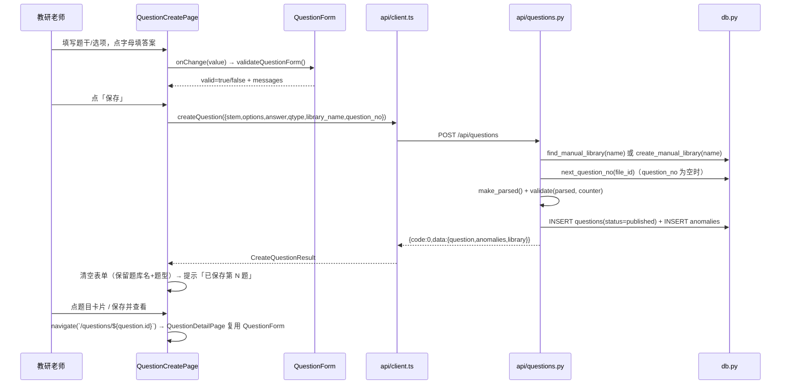
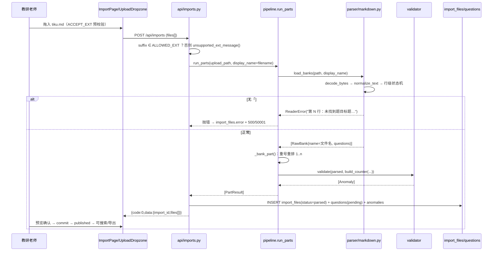
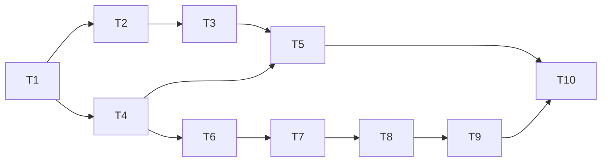

# private-tiku 架构设计（v1.0）

私有护理题库系统：DOCX/TXT/PDF 批量导入 → 规则解析 → 异常标记 → FTS5 全文检索 → 异常校对 → 导出；单容器 Docker 私有化部署，数据全部落 `./data`。

## 1. 技术选型
| 层 | 选型 | 理由 |
|---|---|---|
| 后端 | Python 3.11 + FastAPI + uvicorn | 轻量、自带 OpenAPI、StaticFiles 可托管前端产物 |
| 数据库 | sqlite3 标准库（不引 SQLAlchemy/Alembic） | 单机内网、万级题量、零中间件；直接 SQL 可控 |
| 检索 | SQLite FTS5 `tokenize='trigram'` + `snippet()` | 中文子串匹配无需分词库；命中高亮；万级 <50ms |
| 解析 | 纯 Python 正则 + 状态机（python-docx / pdfplumber / chardet） | 可解释、可复现、无模型依赖，准确率可控 |
| 前端 | Vite + React 18 + MUI 5 + Tailwind 3 | `npm run build` 静态产物由 FastAPI 托管，单容器 |
| 部署 | docker-compose 单服务 + 多阶段 Dockerfile | node 构建前端 → python 运行；SQLite 挂载 `./data` |

## 2. 文件树
```
private-tiku/
├── docker-compose.yml      # 单服务编排，挂载 ./data，暴露端口
├── .env.example            # 环境变量样例（端口/数据目录）
├── README.md               # 部署与使用说明
├── .gitignore              # 忽略 node_modules/dist/data/__pycache__
├── backend/
│   ├── Dockerfile          # 多阶段：node:20 构建前端 → python:3.11-slim 运行
│   ├── requirements.txt    # 后端依赖（见 §8）
│   └── app/
│       ├── __init__.py
│       ├── main.py         # FastAPI 实例、路由注册、StaticFiles 托管 frontend/dist
│       ├── config.py       # 路径/端口/常量（DATA_DIR、DB_PATH、ALLOWED_EXT）
│       ├── db.py           # sqlite3 连接工厂、建表 DDL、FTS 降级检测、初始化
│       ├── models.py       # Pydantic 请求/响应 schema + 枚举常量
│       ├── api/
│       │   ├── __init__.py # APIRouter 聚合
│       │   ├── imports.py  # 上传解析/列表/详情/确认入库/删除
│       │   ├── questions.py# 题目详情/编辑/删除
│       │   ├── search.py   # 全文搜索 + 筛选 + 高亮
│       │   ├── anomalies.py# 异常列表 / 标记已处理
│       │   └── export.py   # JSON/Markdown 导出
│       ├── parser/
│       │   ├── __init__.py
│       │   ├── reader.py   # DOCX/TXT/PDF → 原始文本行（带行号/页码）
│       │   ├── normalize.py# 全半角统一、去空白空行、统一标点
│       │   ├── splitter.py # 按题号正则切分题目块
│       │   ├── extractor.py# 题干/选项/答案/解析/题型抽取
│       │   ├── validator.py# 6 类异常规则判定
│       │   └── pipeline.py # 编排 reader→normalize→splitter→extractor→validator
│       └── tests/
│           ├── test_parser.py  # 解析/异常规则单测
│           ├── test_api.py     # API 集成测试（TestClient）
│           └── fixtures/       # 样例 docx/txt/pdf
├── frontend/
│   ├── package.json        # 前端依赖与脚本
│   ├── vite.config.ts      # 构建配置，base '/'，dev 代理 /api
│   ├── tailwind.config.js  # Tailwind 扫描 src
│   ├── postcss.config.js   # postcss 插件
│   ├── index.html          # SPA 入口
│   ├── tsconfig.json       # TS 配置
│   └── src/
│       ├── main.tsx        # React 挂载 + ThemeProvider + Router
│       ├── App.tsx         # 路由表与整体布局
│       ├── api/client.ts   # axios 封装，baseURL /api，统一解包与报错
│       ├── pages/
│       │   ├── SearchPage.tsx  # 首页：搜索框/筛选/结果高亮
│       │   ├── ImportPage.tsx  # 拖拽上传/导入列表/预览确认入库
│       │   ├── AnomalyPage.tsx # 异常列表/筛选/标记已处理
│       │   ├── QuestionDetailPage.tsx # 题目详情与编辑
│       │   └── StatsPage.tsx   # 题库总量/异常数/导入统计
│       └── components/
│           ├── Layout.tsx      # 侧边导航 + 内容区
│           ├── QuestionCard.tsx# 搜索结果卡片（题型/题干/选项/答案/异常标签）
│           ├── Highlight.tsx   # 安全渲染 <mark> 高亮片段
│           ├── UploadDropzone.tsx # 多文件拖拽/选择上传
│           ├── FilterBar.tsx   # 题型/仅异常/文档筛选
│           └── StatusChip.tsx  # 状态/异常类型彩色徽标
```

## 3. 数据库 DDL
```sql
PRAGMA journal_mode=WAL;
CREATE TABLE IF NOT EXISTS imports (            -- 一次批量导入
  id INTEGER PRIMARY KEY AUTOINCREMENT,
  status TEXT NOT NULL DEFAULT 'parsing',       -- parsing|pending_confirm|committed|failed
  total_files INTEGER NOT NULL DEFAULT 0,
  ok_files INTEGER NOT NULL DEFAULT 0,
  failed_files INTEGER NOT NULL DEFAULT 0,
  total_questions INTEGER NOT NULL DEFAULT 0,
  committed_questions INTEGER NOT NULL DEFAULT 0,
  created_at TEXT NOT NULL DEFAULT (datetime('now','localtime'))
);
CREATE TABLE IF NOT EXISTS import_files (       -- 单个文件
  id INTEGER PRIMARY KEY AUTOINCREMENT,
  import_id INTEGER NOT NULL REFERENCES imports(id) ON DELETE CASCADE,
  filename TEXT NOT NULL,
  file_type TEXT NOT NULL,                       -- docx|txt|pdf
  status TEXT NOT NULL DEFAULT 'parsed',         -- parsed|failed
  error TEXT NOT NULL DEFAULT '',
  total_questions INTEGER NOT NULL DEFAULT 0,
  anomaly_count INTEGER NOT NULL DEFAULT 0,
  created_at TEXT NOT NULL DEFAULT (datetime('now','localtime'))
);
CREATE TABLE IF NOT EXISTS questions (
  id INTEGER PRIMARY KEY AUTOINCREMENT,
  import_file_id INTEGER NOT NULL REFERENCES import_files(id) ON DELETE CASCADE,
  question_no TEXT NOT NULL,                     -- 原文档题号
  qtype TEXT NOT NULL,                           -- single|multiple|judge|unknown
  stem TEXT NOT NULL,
  options_json TEXT NOT NULL DEFAULT '{}',       -- {"A":"...","B":"..."}
  answer TEXT NOT NULL DEFAULT '',               -- 单选"A"/多选"ABD"/判断"√"|"×"
  analysis TEXT NOT NULL DEFAULT '',
  status TEXT NOT NULL DEFAULT 'pending',        -- pending|published
  created_at TEXT NOT NULL DEFAULT (datetime('now','localtime')),
  updated_at TEXT NOT NULL DEFAULT (datetime('now','localtime'))
);
CREATE INDEX IF NOT EXISTS idx_q_file   ON questions(import_file_id);
CREATE INDEX IF NOT EXISTS idx_q_status ON questions(status);
CREATE INDEX IF NOT EXISTS idx_q_type   ON questions(qtype);
CREATE TABLE IF NOT EXISTS anomalies (
  id INTEGER PRIMARY KEY AUTOINCREMENT,
  question_id INTEGER NOT NULL REFERENCES questions(id) ON DELETE CASCADE,
  type TEXT NOT NULL,                            -- 见 §6 异常枚举
  detail TEXT NOT NULL DEFAULT '',
  handled INTEGER NOT NULL DEFAULT 0,            -- 0 未处理 / 1 已处理
  created_at TEXT NOT NULL DEFAULT (datetime('now','localtime'))
);
CREATE INDEX IF NOT EXISTS idx_a_q     ON anomalies(question_id);
CREATE INDEX IF NOT EXISTS idx_a_state ON anomalies(type, handled);

-- FTS5 外部内容表：列与 questions 对齐，content_rowid 关联主键
CREATE VIRTUAL TABLE IF NOT EXISTS questions_fts USING fts5(
  stem, options_json, answer, analysis,
  content='questions', content_rowid='id', tokenize='trigram'
);
-- 三触发器：FTS 与 questions 自动同步
CREATE TRIGGER IF NOT EXISTS q_ai AFTER INSERT ON questions BEGIN
  INSERT INTO questions_fts(rowid, stem, options_json, answer, analysis)
  VALUES (new.id, new.stem, new.options_json, new.answer, new.analysis);
END;
CREATE TRIGGER IF NOT EXISTS q_ad AFTER DELETE ON questions BEGIN
  INSERT INTO questions_fts(questions_fts, rowid, stem, options_json, answer, analysis)
  VALUES ('delete', old.id, old.stem, old.options_json, old.answer, old.analysis);
END;
CREATE TRIGGER IF NOT EXISTS q_au AFTER UPDATE ON questions BEGIN
  INSERT INTO questions_fts(questions_fts, rowid, stem, options_json, answer, analysis)
  VALUES ('delete', old.id, old.stem, old.options_json, old.answer, old.analysis);
  INSERT INTO questions_fts(rowid, stem, options_json, answer, analysis)
  VALUES (new.id, new.stem, new.options_json, new.answer, new.analysis);
END;
```
**FTS 降级策略**：`db.py` 建 FTS 表时 try/except——SQLite 不支持 `trigram`（<3.34）则改 `tokenize='unicode61'` 并置全局标志 `FTS_TRIGRAM=False`；搜索层据标志决定用 `MATCH` 还是 `LIKE`。**trigram 限制**：`MATCH` 需 ≥3 字符；<3 字符（如"房颤"）退化为 `WHERE stem LIKE '%q%' OR options_json LIKE ...`（万级 LIKE 仍 <100ms）。多关键词：`"kw1" AND "kw2"`。

## 4. API 设计（统一响应 `{code,message,data}`，snake_case）
| 方法 | 路径 | 说明 | 请求 | 响应 data |
|---|---|---|---|---|
| POST | /api/imports | multipart 多文件上传→同步解析→暂存待确认 | form `files[]` | `{import_id, files:[{file_id,filename,status,error,total_questions,anomaly_count}]}` |
| GET | /api/imports | 导入记录列表 | `?page=&size=` | `{items:[import],total}` |
| GET | /api/imports/{id} | 导入详情（含文件明细） | - | `{import, files:[...]}` |
| POST | /api/imports/{id}/commit | 确认入库（pending→published） | - | `{committed}` |
| DELETE | /api/imports/{id} | 删除导入及其题目/异常（级联） | - | `{deleted}` |
| GET | /api/search | 全文搜索 + 筛选 + 高亮 | `?q=&type=&only_anomaly=&doc_id=&page=&size=` | `{items:[question+highlight],total,took_ms}` |
| GET | /api/questions/{id} | 题目详情（含异常列表） | - | `{question, anomalies}` |
| PUT | /api/questions/{id} | 编辑题目并重算异常 | `{stem,options,answer,analysis,qtype}` | `{question, anomalies}` |
| DELETE | /api/questions/{id} | 删除题目（触发 FTS 同步删除） | - | `{deleted}` |
| GET | /api/anomalies | 异常列表 | `?type=&handled=&page=&size=` | `{items:[{anomaly,question}],total}` |
| PATCH | /api/anomalies/{id} | 标记异常已处理 | `{handled:true}` | `{anomaly}` |
| GET | /api/export | 导出题库 | `?format=json\|md` | 文件流（Content-Disposition） |
| GET | /api/stats | 统计面板 | - | `{total_published,total_pending,anomaly_open,total_imports}` |
| GET | /api/health | 健康检查 | - | `{status:'ok'}` |
**错误码**：`0` 成功；`40001` 参数错误；`40401` 资源不存在；`42201` 文件类型不支持；`50001` 解析失败。HTTP 状态码配合（400/404/422/500），body 仍为统一结构。
## 5. 解析管线（输入输出）
```
Reader.read(path) -> list[Line(seq:int, text:str, page:int|None)]
  按扩展名分发：python-docx 取段落；pdfplumber 取每页文本行；chardet 探测编码后按行读
normalize(lines) -> list[Line]   # 全角→半角、去首尾空白、去空行、统一（ ）．等标点
splitter.split(lines) -> list[Block(no_text:str, lines:list[Line])]
  题号正则 ^\s*(?:第?\s*)?(\d{1,4})\s*[.、．。)）]\s* 命中即开新块
extractor.extract(block) -> Parsed(no, stem, options:dict, answer, analysis, qtype)
  · 首行去题号→题干；题干内联选项用 "A. xxx B. xxx" 拆分
  · 选项行正则 ^[A-H][.、．)）]\s* 逐行收集
  · 答案行 (?:参考)?答案[:：]?\s*(\S+)；解析行 解析[:：]?\s*(.+)
validator.validate(parsed, no_counter) -> list[Anomaly(type, detail)]
pipeline.run(file) -> list[(Parsed, list[Anomaly])]   # 供 imports.py 落库
```

## 6. 题型判定与异常规则
**题型判定（按优先级）**

| 条件 | qtype |
|---|---|
| 无选项且答案 ∈ {对,错,正确,错误,√,×,T,F} | `judge` |
| 答案含 ≥2 个字母 | `multiple` |
| 答案恰 1 个字母（A-H） | `single` |
| 其他无法识别 | `unknown` |

**异常规则（枚举固定）**

| type | 判定规则 |
|---|---|
| `missing_answer` | answer 为空 |
| `missing_options` | qtype∈{single,multiple} 且选项数=0 |
| `too_few_options` | qtype∈{single,multiple} 且 0<选项数<4 |
| `empty_stem` | 题干去空白后长度 <3 |
| `duplicate_number` | 同一文件内题号重复（Counter>1） |
| `parse_error` | 切分/抽取抛异常或无题号可识别 |

**答案规范化**：多选字母升序大写；判断统一为 `√`/`×`（对/正确/T/√→√，错/错误/F/×→×）。

## 7. 任务分解
| 任务 | 标题 | 依赖 | 涉及文件 | 验收点 |
|---|---|---|---|---|
| T01 | 项目基础设施与骨架 | - | docker-compose.yml、.env.example、.gitignore、README.md、backend/Dockerfile、requirements.txt、app/main.py、app/config.py、frontend 全套基座（package.json/vite.config.ts/tailwind.config.js/postcss.config.js/index.html/tsconfig.json/src/main.tsx/src/App.tsx/src/api/client.ts/src/components/Layout.tsx） | `docker compose up -d` 启动；/api/health 返回 ok；StaticFiles 托管可访问；npm build 成功 |
| T02 | 数据层与解析引擎 | T01 | app/db.py、app/models.py、app/parser/__init__.py、reader.py、normalize.py、splitter.py、extractor.py、validator.py、pipeline.py、tests/test_parser.py、tests/fixtures/ | 建表+触发器幂等；三格式解析出结构化题目；6 类异常规则单测通过 |
| T03 | 后端 API | T02 | app/api/__init__.py、imports.py、questions.py、search.py、anomalies.py、export.py、main.py（注册路由） | curl 全链路：上传→列表→详情→commit→search(高亮/筛选)→题目编辑→异常列表/标记→导出；错误码规范 |
| T04 | 前端页面与组件 | T01（可与 T02/T03 并行） | src/pages/SearchPage.tsx、ImportPage.tsx、AnomalyPage.tsx、QuestionDetailPage.tsx、StatsPage.tsx、src/components/QuestionCard.tsx、Highlight.tsx、UploadDropzone.tsx、FilterBar.tsx、StatusChip.tsx | 4+ 页面可用；上传/搜索结果高亮/异常校对/详情编辑闭环；MUI+Tailwind 统一 |
| T05 | QA 测试与端到端验收 | T02、T03、T04 | app/tests/test_api.py、tests/fixtures/、修复缺陷（跨 T02–T04 文件） | 解析准确率抽检 ≥90%；API 全用例通过；docker 一键部署端到端演示（诱导异常→修复→导出）；性能：万题搜索 <1s |

## 8. 依赖清单与共享约定
**backend/requirements.txt**
```
fastapi==0.111.0
uvicorn[standard]==0.30.1
python-multipart==0.0.9
python-docx==1.1.2
pdfplumber==0.11.0
chardet==5.2.0
pydantic==2.7.4
pytest==8.2.2
httpx==0.27.0
```

**frontend/package.json dependencies**
```
react 18.3.1 · react-dom 18.3.1 · react-router-dom 6.24.0 · @mui/material 5.16.0 ·
@mui/icons-material 5.16.0 · @emotion/react 11.11.4 · @emotion/styled 11.11.5 · axios 1.7.2
devDependencies: vite 5.3.3 · @vitejs/plugin-react 4.3.1 · typescript 5.5.3 · tailwindcss 3.4.4 ·
postcss 8.4.39 · autoprefixer 10.4.19 · @types/react 18.3.3 · @types/react-dom 18.3.0
```

**跨文件共享约定**
- 字段一律 `snake_case`；API 响应统一 `{code:0, message:"ok", data:{...}}`。
- 题目 JSON：`{id, import_file_id, question_no, qtype, stem, options:{"A":".."}, answer, analysis, status, anomalies:[{type,detail,handled}]}`。
- 题型枚举：`single|multiple|judge|unknown`；异常枚举：`missing_answer|missing_options|empty_stem|duplicate_number|too_few_options|parse_error`；题目状态：`pending|published`；导入状态：`parsing|pending_confirm|committed|failed`。
- 只检索 `status='published'` 题目；上传仅接受 `.docx/.txt/.pdf`，落盘名 `{uuid}{ext}`，原文件名存库。
- 前端所有请求走 `src/api/client.ts`（baseURL `/api`），错误统一 toast；高亮片段由后端转义后以 `<mark>` 包裹，前端 `Highlight.tsx` 安全渲染（禁直插未转义内容）。
- 异常翻新：`PUT /questions/{id}` 后按最新内容**全量重建**该题 anomalies，避免脏数据残留。

**待明确事项**
1. 题量上限按万级设计；十万级需迁移独立搜索引擎（接口已隔离）。
2. PDF 扫描件 OCR 不在本期（文本型 PDF 之外走 `parse_error`/"无可提取文本"）。
3. "缺选项"阈值定为 <4（护理选择题通常四选项），如需按题型区分可后续调整。
4. 无答案但有解析：正常入库并标 `missing_answer`，不阻断。
5. 权限/多用户未做（单管理员内网模式）；如需公网暴露需前置反代鉴权。

## v1.3 增量设计

> 范围：导入格式收敛为 JSON + Markdown、Markdown 往返导入、手动录题（`POST /api/questions`）、答案点选。
> 未提及的 v1.0–v1.2 设计全部沿用；**历史数据零迁移**（`file_type=docx/txt/pdf` 记录、其题目/异常/已处理状态原样保留）。
> 相对 PRD 的唯一偏离：**删除中间选项不做字母前移**（见 §4.3），PRD v1.3.6「删 B 后 C→B」作废。

### 1. 改动文件清单

| 路径 | 类型 | 一句话职责 |
|---|---|---|
| `backend/app/config.py` | 改 | `ALLOWED_EXT={.json,.md,.markdown}`、`FILE_TYPE_BY_EXT`（`.md/.markdown`→`md`）、`ALLOWED_EXT_HINT=".json/.md"`；新增 `UNSUPPORTED_EXT_TEMPLATE`/`unsupported_ext_message()`、`MANUAL_FILE_TYPE="manual"`、`DEFAULT_LIBRARY_NAME="手动录入"` |
| `backend/app/parser/reader.py` | 改 | 精简为 `ReaderError` + `decode_bytes()`（原 `_decode_bytes`，chardet 兜底）；删 `read()`、`_read_txt/_read_docx/_read_pdf`、`Line`、`_lines_from_text` |
| `backend/app/parser/normalize.py` | 改 | 保留 `normalize_text()`（全角→半角，`【】`→`[]`、`（）`→`()`）；删 `normalize(lines)` |
| `backend/app/parser/extractor.py` | 改 | 保留 `Parsed`/`OPTION_RE`/`ANSWER_RE`/`ANALYSIS_RE`/`JUDGE_*`/`decide_qtype`/`normalize_answer`/`make_parsed`；`_split_inline_options`→`split_inline_options` 公开；删 `extract()`/`_extract_inner()`/`_split_trailing()`/`_take_answer_token()` |
| `backend/app/parser/splitter.py` | 删 | 题号文本切分随 docx/txt/pdf 一并下线（md 用 `## ` 显式分题，不再需要） |
| `backend/app/parser/markdown.py` | 增 | Markdown → `List[jsonbank.RawBank]`（恒 1 个 bank）；行级状态机 + 行号定位报错 |
| `backend/app/parser/jsonbank.py` | 改 | 私有函数改可复用：`_type_of`→`map_qtype`、`_fold_judge_options`→`fold_judge_options`、新增 `resolve_qtype(declared, options, answer)`；改 import 来源（`split_inline_options`、`decode_bytes`） |
| `backend/app/parser/pipeline.py` | 改 | `run_parts` 增加 `.md/.markdown` 分支 → `markdown.load_banks` → `_bank_part`；删 `run_lines/_run_text`，`run()` 保留为 `run_parts` 包装 |
| `backend/app/api/imports.py` | 改 | 类型预校验错误文案改走 `config.unsupported_ext_message(suffix)`；`only_type_error` 判定与 42201 message 同步（`data.files[].error` 与前端字字一致） |
| `backend/app/api/questions.py` | 改 | 新增 `POST /api/questions`（手录单题）；`PUT` 逻辑不变 |
| `backend/app/api/libraries.py` | 增 | `GET /api/libraries`（题库名称下拉数据源） |
| `backend/app/api/__init__.py` | 改 | 注册 `libraries.router` |
| `backend/app/models.py` | 改 | 新增 `QuestionCreateRequest(QuestionUpdateRequest + library_name/question_no)`；`QType` 复用 |
| `backend/app/db.py` | 改 | 新增 `find_manual_library()`、`create_manual_library()`、`next_question_no()`、`list_libraries()`；LIVE 列/触发器不动 |
| `backend/requirements.txt` | 改 | 删 `python-docx`、`pdfplumber`（保留 `chardet` 供 md 解码） |
| `backend/app/tests/test_markdown.py` | 增 | md 状态机变体矩阵 + 往返一致性 + 报错行号 |
| `backend/app/tests/test_text_parity.py` | 增 | 断言后端文案常量与 `frontend/src/constants/import.ts` 字面量一致（防漂移） |
| `backend/app/tests/test_api.py` | 改 | 样本 `*_TXT` 改 `*_MD`；`test_upload_multi_format_and_import_detail`→两格式（json+md）；新增 POST/libraries 用例 |
| `backend/app/tests/test_regressions.py` | 改 | `MAIN_TXT`/`_upload(..., "main.txt")` 改 md 样本 |
| `backend/app/tests/test_parser.py` | 改 | 删 text 管线用例（见 §8），保留 normalize/题型/答案/validator |
| `backend/app/tests/test_accuracy.py` | 删 | 其「解析准确率」价值由 md 往返一致性用例继承 |
| `backend/app/tests/fixtures/*` | 改 | 删 `sample_basic.txt`/`sample_gbk.txt`/`sample_messy.txt`/`sample_questions.docx/pdf`/`accuracy_100*.{txt,json}`；增 `sample_basic.md`、`sample_messy.md`（无 `## ` 标题）、`sample_variants.md` |
| `backend/scripts/gen_fixtures.py`、`gen_accuracy_fixture.py`、`accuracy_check.py` | 删 | 只服务于已下线的 docx/pdf/txt 样本 |
| `backend/scripts/e2e_demo.sh`、`smoke_test.sh` | 改 | 上传样本 `.txt`→`.md`（`dirty_basic.txt`→`dirty_basic.md` 等，内容按 §2 语法） |
| `frontend/src/api/client.ts` | 改 | 新增 `createQuestion()`/`listLibraries()` + `LibraryItem`/`CreateQuestionPayload`/`CreateQuestionResult` 类型 |
| `frontend/src/constants/import.ts` | 增 | `ACCEPT_EXT`、`unsupportedExtMessage()`、`DEFAULT_LIBRARY_NAME`、`MD_TEMPLATE`（模板下载用） |
| `frontend/src/utils/questionForm.ts` | 增 | 纯函数：`toggleLetter`/`setJudgeAnswer`/`normalizeAnswerInput`/`nextLetter`/`validateQuestionForm` |
| `frontend/src/components/AnswerPicker.tsx` | 增 | 点选填答案（单选/多选/判断），双向同步与置灰 |
| `frontend/src/components/QuestionForm.tsx` | 增 | 受控表单（题干/选项/题型/答案/解析 + 可选题库名与题号），create/edit 共用 |
| `frontend/src/pages/QuestionCreatePage.tsx` | 增 | 手动录题页 `/questions/new`：保存 / 保存并继续 / 清空 |
| `frontend/src/pages/QuestionDetailPage.tsx` | 改 | 改为复用 `QuestionForm`，保留保存/删除/异常校对 |
| `frontend/src/App.tsx` | 改 | 新增路由 `/questions/new`（放在 `/questions/:id` **之前**，否则 `new` 被当 id） |
| `frontend/src/components/Layout.tsx` | 改 | `NAV_ITEMS` 第 5 项「手动录题」；顶部副标题改「JSON / Markdown 导入 · 规则解析 · 全文检索 · 异常校对 · 手动录题 · 一键导出」 |
| `frontend/src/components/UploadDropzone.tsx` | 改 | `ACCEPT_EXT` 与提示文案改引用 `constants/import.ts`；拒绝提示走 `unsupportedExtMessage()` |
| `frontend/src/pages/ImportPage.tsx` | 改 | 「支持格式」提示改 JSON/Markdown + 「一个 md = 一个题库」；折叠写法示例 + `tiku-template.md` 下载（P1-8） |
| `README.md` | 改 | 导入说明、格式表、依赖说明、已知限制中所有 docx/txt/pdf 表述 |
| `docs/ARCHITECTURE.md` | 改 | 本节 |

CI/部署：无 CI 配置；`backend/Dockerfile` 与 `deploy/fnos` 不引用被删依赖，**无需改动**（构建走 `requirements.txt`）。

### 2. Markdown 解析器设计

**契约**
```python
def load_banks(path: Path | str, display_name: str | None = None) -> list[jsonbank.RawBank]  # 恒 1 个 bank
def parse_bank(text: str, name: str) -> jsonbank.RawBank        # 纯函数，供单测
# RawBank(name=display_name or 文件名, questions=[Parsed(no, stem, options, answer, analysis, qtype)])
# 失败一律抛 ReaderError（带行号）；单题缺陷不抛，落 Parsed 字段由 validator 转异常
```

**逐行状态机**（`state ∈ HEADER | STEM | OPTION | ANSWER | ANALYSIS`；每行先 `normalize_text()` 再匹配，保留 1-based 行号）

| 当前状态 | 输入 | 动作 | 次态 |
|---|---|---|---|
| 任意 | `^##\s+` 题目标题 | 结算上一题 → 开新题（解析题号/题型）；记录 `heading_lines` | STEM |
| HEADER | 空行 / `^#\s` / `- 导出时间：`·`- 题目总数：` | 丢弃 | HEADER |
| HEADER | 其它非空行 | 丢弃，并记下**首个非空行行号**（供「未找到题目标题」定位） | HEADER |
| STEM | 空行 | 忽略 | STEM |
| STEM | 选项行 | `options[letter]=text` | OPTION |
| STEM | 答案行 / 解析行 | 记 `answer` / 进解析 | ANSWER / ANALYSIS |
| STEM | 来源行 / 异常标记行 / `^---$` | 丢弃（**来源统一取文件名**） | STEM |
| STEM | 普通文本 | 题干追加（多行用单空格拼接） | STEM |
| OPTION | 选项行 | 覆盖/新增该字母 | OPTION |
| OPTION | 答案行 / 解析行 / 忽略行 / `## ` | 按对应规则 | ANSWER / ANALYSIS / — |
| OPTION | 普通文本 | 并入**最后一个选项**（空格拼接，兼容软换行） | OPTION |
| ANSWER | 解析行 | 进解析 | ANALYSIS |
| ANSWER | 其它行 | 丢弃（避免「答案：A 是否正确」类尾注污染答案） | ANSWER |
| ANALYSIS | 普通文本 | 解析追加（单空格拼接，**保证二次往返收敛**） | ANALYSIS |
| ANALYSIS | `^---$` / 来源行 / 异常标记行 | 丢弃 | ANALYSIS |
| EOF | — | 结算最后一题 | — |

**正则清单**（全部作用于 `normalize_text()` 之后的行，`：`已为半角但仍兼容全角）

| 用途 | 正则 |
|---|---|
| 题目标题 | `^##\s+(?P<rest>.+)$` |
| 题型标记 | `[\[(](?P<tag>[^\])]{1,12})[\])]` → `jsonbank.map_qtype(tag)`（`单选题/单选/…`、`[single]/[multiple]/[judge]`；`未知题型`→`None`） |
| 题号 | 去掉题型标记后 `^(?:第\s*)?(?P<no>\d{1,4})\s*(?:[.、:：)）]\|\s\|$)`；纯数字则用其值，否则 `None` → **按出现顺序补 1..n** |
| 选项 | `^(?:[-*+]\s+)?\*{0,2}(?P<l>[A-H])\s*\*{0,2}[.、:：)）]\s*(?P<t>.*)$`（覆盖 `- **A.** x`、`- A. x`、`A. x`、`A：x`、`- **A、** x`） |
| 答案 | `^\*{0,2}(?:参考答案\|正确答案\|标准答案\|答案)\*{0,2}\s*[:：]\s*(?P<v>.*)$` |
| 解析 | `^\*{0,2}(?:答案解析\|试题解析\|题目解析\|解析\|分析\|解答)\*{0,2}\s*[:：]\s*(?P<v>.*)$` |
| 忽略行 | `^\*{0,2}(?:来源\|异常标记)\*{0,2}\s*[:：]`、`^---+\s*$`、`^#\s` |
| 占位符 | `\(题干为空\)`→`stem=""`、`\(无答案\)`→`answer=""`（导出占位往返还原，落 `empty_stem`/`missing_answer`） |

**变体归一策略**：题号分隔符 4 种写法靠「去标记后首 token 是数字」统一；题型缺失或无法识别 → `jsonbank.resolve_qtype(None, options, answer)`（即 `decide_qtype`），声明为 single/multiple 但与答案字母个数冲突时**以答案为准**（与 JSON 导入同一条规则，杜绝 `normalize_answer` 静默丢字母）；判断题答案 `√/×/对/错/正确/错误/T/F` 走 `normalize_answer(…,'judge')`，`A/B` 仅当选项内容为「正确/错误」时经 `jsonbank.fold_judge_options` 折叠为 `√/×` 且清空选项；答案字母 `re.sub(r"[^A-Za-z]","",v).upper()` 去空格与分隔符；`**`/`__` 通过 `\*{0,2}` 吸收；CRLF/BOM/全角/GBK 由 `decode_bytes` + `normalize_text` 承担。

**错误模型**

| 场景 | 行为 | 落点 |
|---|---|---|
| 文件为空/不可解码 | `ReaderError("文件内容为空")` | `import_files.error` + `data.files[].error`，HTTP 500/50001（沿用现有 `ok_files==0` 分支） |
| 全文无 `## ` 标题 | `ReaderError("第 {N} 行：未找到题目标题，需要 `## 1. [单选题]` 形式")`，`N` = 首个非空行行号 | 同上 |
| 有标题但 0 题 | `ReaderError("第 {首个标题行} 行：未识别到任何题目内容")` | 同上 |
| 单题缺题干/选项/答案 | **不抛**，置空让 `validate()` 产出 `empty_stem`/`missing_options`/`missing_answer` | `anomalies` 表 |
| 单题块内无任何有效内容 | `Parsed(parse_error=True, error_detail="第 {N} 行起的题目块无有效内容")` | `anomalies.parse_error`，**该文件仍算解析成功** |
| 题号重复 | 不报错；`_bank_part` 已有「重号则按顺序重排 1..n」，无重号保持原题号 | 题号列 |

### 3. API 契约

**`POST /api/questions`**（请求体字段 = `QuestionUpdateRequest` + `library_name` + `question_no`；外壳 `{code,message,data}`，成功 HTTP 200）
```json
{ "stem": "患者男，65 岁，突发胸痛 2 小时……", "options": {"A":"心房颤动","B":"心室颤动","C":"心房扑动","D":"期前收缩"},
  "answer": "A", "analysis": "房颤时脉率少于心率……", "qtype": "single",
  "library_name": "手动录入", "question_no": null }
```
```json
{ "code": 0, "message": "ok", "data": {
    "question": { "id": 501, "import_file_id": 12, "question_no": "12", "qtype": "single", "status": "published",
                  "options": {"A":"心房颤动"}, "answer": "A", "anomalies": [] },
    "anomalies": [],
    "library": { "id": 12, "name": "手动录入", "file_type": "manual", "created": true } } }
```
落库规则：`library_name.strip()`（∩ 缺省 `"手动录入"`）→ `import_files.filename`；`file_type='manual'`、`status='parsed'`；首次建库同事务插一条 `imports(status='committed', total_files=1, ok_files=1)`，计数列写 0，读取侧一律走 `IMPORT_LIVE_COLUMNS` 实时聚合（与 `/api/imports` 口径一致）；同名库复用 `id` 最小那条；`question_no` 留空 → 该 file 内**纯数字题号 max+1**（无数字题号时取 1）；`status='published'`；写入后 `validate(parsed, {no: count_same_number(...)})` 全量落 `anomalies`（与 PUT 同口径）。

| 分支 | HTTP | code | message |
|---|---|---|---|
| 题干空（trim 后为空） | 400 | 40001 | `题干不能为空` |
| 题库名空且未给缺省 | 400 | 40001 | `题库名称不能为空` |
| 题库名 >120 字 / 题号 >32 字 | 400 | 40001 | `题库名称最多 120 字` / `题号最多 32 字` |
| 题型缺失或 `unknown` | 400 | 40001 | `题型只能是 single / multiple / judge`（Pydantic 枚举校验） |
| 选择题答案字母不在已填选项内 | 400 | 40001 | `答案「BD」中的 D 不在已填写选项内（现有：A、B、C）` |
| 判断题答案不是 √/× | 400 | 40001 | `判断题答案只能是 √ 或 ×` |
| 选择题答案为空 | 400 | 40001 | `请填写答案` |

> 说明：题干 1–2 字**不拦**（交 `empty_stem` 异常，与导入一致）；`PUT /api/questions/{id}` 不加上述校验（校对路径必须能修坏数据，且避免破坏既有用例）。显式填写的重复题号**不拦**，落 `duplicate_number` 异常。

**`GET /api/libraries`**（无参数；上限 500 条防御）
```json
{ "code": 0, "message": "ok", "data": { "items": [
  { "id": 12, "name": "手动录入", "file_type": "manual", "kind": "manual",   "question_count": 37, "last_updated": "2025-01-02 10:11:12" },
  { "id": 3,  "name": "1-胡英芳--静脉治疗护理技术操作标准试题.docx", "file_type": "docx", "kind": "docx", "question_count": 40, "last_updated": "2024-12-20 09:00:00" } ] } }
```
`kind` ∈ `manual|json|md|docx|txt|pdf|other`（`file_type` 直出，脏值归 `other`）。聚合：按 `filename` 分组（同名历史 docx 多次导入合并为一条）→ `id`=组内最小 `import_files.id`、`question_count`=组内题目数合计、`kind`=该条 `file_type`、`last_updated`=`MAX(questions.updated_at)` 兜底 `MAX(import_files.created_at)`；过滤 `question_count>0`；排序 `last_updated DESC, name ASC`（刚录过的库排最前）。

### 4. 前端组件契约

**4.1 `AnswerPicker`**
```ts
export interface AnswerPickerProps {
  qtype: QType;                          // single | multiple | judge（unknown 时整块隐藏）
  answer: string;                        // 受控：'A' | 'ABD' | '√' | '×' | ''
  options: Record<string, string>;       // 用于判定「未填写 → 置灰」
  onChange: (next: string) => void;      // 只回传规范化后的答案
  disabled?: boolean;
}
```
**4.2 `QuestionForm`**
```ts
export interface QuestionFormValue {
  stem: string; qtype: QType; options: Record<string, string>;
  answer: string; analysis: string;
  libraryName: string;   // 仅 mode='create' 使用
  questionNo: string;    // 仅 mode='create' 使用（空串 = 自动取下一号）
}
export interface QuestionFormProps {
  value: QuestionFormValue;
  onChange: (next: QuestionFormValue) => void;
  mode: 'create' | 'edit';
  libraries?: LibraryItem[];             // mode='create' 下拉候选（可自由输入新建）
  librariesLoading?: boolean;
  qtypeOptions?: QType[];                // create 传 3 项；edit 传 4 项（含 unknown，兼容历史）
  disabled?: boolean;
  onValidityChange?: (result: QuestionFormValidation) => void;
  children?: React.ReactNode;            // 动作区插槽（保存/删除/清空由页面注入）
}
export interface QuestionFormValidation { valid: boolean; messages: string[]; optionWarnings: string[] }
```
**4.3 交互与校验规则**（`utils/questionForm.ts` 纯函数实现，页面与后端共用同一套口径）

| 场景 | 行为 |
|---|---|
| 单选 | 点字母 → 答案=该字母；再点同字母 → 清空 |
| 多选 | 点字母 → 并入并 A→H 升序；再点已选 → 移除，空则 `''` |
| 判断 | 仅 `√` `×` 两键，互斥；再点同键清空；切到判断题时清空选项与答案 |
| 未填内容的选项 | 按钮置灰 + `title="请先填写选项 D 的内容"` |
| 手输答案 | 去分隔符、转大写、去重（`A,B`→`AB`）；合法时点选区同步高亮 |
| 删除选项 | **只删该字母，后续字母不前移**（A、B、D 保持 A、B、D）；新增选项填入首个未使用字母（`nextLetter`）。理由：与 v1.2 编辑页行为一致、避免「改一个字母牵动全文」；PRD v1.3.6「删 B 后 C→B」作废 |
| 提交 payload | 只含**非空**选项（`trim()` 后过滤），避免 `{"D":""}` 造成字母空洞 |
| 题干 <3 字 | 禁用保存 + 「题干至少 3 个字」 |
| 选择题选项为空 | 禁用保存 + 「选择题至少需要 1 个选项」 |
| 答案为空 | 禁用保存 + 「请填写答案或点击字母」 |
| 单选答案 ≥2 字母 / 字母不在选项内 / 含非 A–H 字符 / 判断答案非 √× | 禁用保存 + 红字「答案只能是已填写选项的字母组合，判断题请用 √ / ×」 |
| 选项 1–3 个 | **不阻塞**，仅黄字提示「选项不足 4 项，保存后会标记为异常」 |
| 题库名空（create） | 禁用保存 + 「请选择或输入题库名称」 |

### 5. 调用时序





### 6. 任务列表（按实现顺序，8–12 粒度）

| ID | 任务 | 依赖 | 涉及文件 | 验收要点 |
|---|---|---|---|---|
| T1 | **格式契约收敛（后端入口）** | — | `config.py`、`api/imports.py`、`parser/reader.py`、`requirements.txt` | `.docx/.txt/.pdf` 上传 → 422/42201 且 `data.files[].error` 逐字等于 PRD 文案；`.json` 导入回归全绿 |
| T2 | **Markdown 解析器** | T1 | `parser/markdown.py`、`parser/normalize.py`、`parser/extractor.py`、`parser/jsonbank.py`、`parser/pipeline.py` | 导出 md 原样重导 → 题量/题干/选项/答案/解析/题型逐题一致；v1.3.4 变体全可解；无标题报「第 N 行」 |
| T3 | **文本管线下线与测试基座迁移** | T1、T2 | 删 `parser/splitter.py`、`tests/test_parser.py`、`tests/test_accuracy.py`、`tests/fixtures/*`、`tests/test_api.py`、`tests/test_regressions.py` | `pytest` 全绿；测试样本全部 `.md`；无 docx/pdf/txt fixture 残留 |
| T4 | **手录后端（题目写入 + 题库聚合）** | T1 | `db.py`、`models.py`、`api/questions.py`、`api/libraries.py`、`api/__init__.py` | `POST /api/questions` 七条错误分支逐一命中；同名库复用；题号留空取 max+1；`GET /api/libraries` 含历史 docx 来源 |
| T5 | **后端测试补齐** | T2、T3、T4 | `tests/test_markdown.py`、`tests/test_text_parity.py`、`tests/test_api.py` | md 变体矩阵 + 往返 + 手录 CRUD + libraries + 文案 parity 全部通过 |
| T6 | **前端数据层与常量** | T4 | `api/client.ts`、`constants/import.ts` | `createQuestion`/`listLibraries` 类型对齐 snake_case；`unsupportedExtMessage()` 与后端一致 |
| T7 | **AnswerPicker + 表单纯函数** | T6 | `components/AnswerPicker.tsx`、`utils/questionForm.ts` | 单选/多选/判断点击与清空、置灰、手输去重同步、删除不前移全部见 §4.3 |
| T8 | **QuestionForm + 详情页改造** | T7 | `components/QuestionForm.tsx`、`pages/QuestionDetailPage.tsx` | 详情页编辑/保存/删除/异常校对行为**不回归**；表单零内部状态（受控） |
| T9 | **录题页 + 路由 + 导航与文案** | T8 | `pages/QuestionCreatePage.tsx`、`App.tsx`、`components/Layout.tsx`、`components/UploadDropzone.tsx`、`pages/ImportPage.tsx` | `/questions/new` 可录题并跳详情；导航 5 项；上传区文案/可选项与后端一致；`npm run build` 通过 |
| T10 | **文档、脚本与端到端联调** | T2–T9 | `README.md`、`scripts/e2e_demo.sh`、`scripts/smoke_test.sh`、删 `scripts/gen_fixtures.py`/`gen_accuracy_fixture.py`/`accuracy_check.py` | `smoke_test.sh`/`e2e_demo.sh` PASS；README 无 docx/txt/pdf 残留表述；容器重建后可用 |



### 7. 共享约定

- **不新增错误码**：复用 `models.py` 的 `CODE_PARAM_ERROR(40001)`、`CODE_NOT_FOUND(40401)`、`CODE_UNSUPPORTED_TYPE(42201)`、`CODE_PARSE_FAILED(50001)`；响应外壳恒为 `{code,message,data}`。
- **文案唯一来源**：后端 `config.UNSUPPORTED_EXT_TEMPLATE` + `config.unsupported_ext_message(ext)`；前端 `src/constants/import.ts::unsupportedExtMessage()`。二者由 `tests/test_text_parity.py` 读取前端源码字面量断言相等 —— **改文案必须同时改两处并跑该用例**。同理 `DEFAULT_LIBRARY_NAME="手动录入"`。
- **`file_type` 取值表**：`json | md | docx | txt | pdf | manual`。其中 `docx/txt/pdf` 仅存在于历史数据；`manual` 仅由 `POST /api/questions` 产生；`.markdown` 统一落 `md`，前端展示统一为「Markdown」。
- **kind 派生**：`file_type` 直出，未知值 → `other`（`GET /api/libraries`）。
- **命名**：API 字段一律 `snake_case`；TS 表单内部值用 camelCase（`libraryName`/`questionNo`），仅在 `api.createQuestion()` 调用处映射；题型/异常/状态枚举字符串与后端枚举**逐字一致**。
- **口径一致性**：所有计数展示走实时聚合（`IMPORT_LIVE_COLUMNS`/`FILE_LIVE_COLUMNS`），手录库与导入库同一口径；异常一律 `validate()` 同一入口产出、编辑/新建后**全量重建**。
- **状态**：导入题 = `pending` → commit → `published`；手录题直接 `published`（无 pending 态）。

### 8. 风险与回归点

**会因移除 docx/pdf/txt 而失败/需改写的既有用例**（已 grep 确认）

| 测试文件 | 用例 | 处理 |
|---|---|---|
| `test_parser.py` | `test_reader_txt_utf8`/`test_reader_txt_gbk`/`test_reader_docx`/`test_reader_pdf`/`test_reader_rejects_unknown_extension`/`test_reader_rejects_empty_file` | 删；`empty/unknown` 语义迁到 `test_markdown.py` |
| `test_parser.py` | `test_pipeline_basic_txt`/`test_pipeline_messy_txt_all_parse_error`/`test_pipeline_docx`/`test_pipeline_pdf`/`test_pipeline_gbk`/`test_pipeline_counts_match` | 删，等价断言在 `test_markdown.py` 用 md 重建 |
| `test_parser.py` | `test_match_no`/`test_split_creates_blocks_and_drops_preamble`/`test_split_without_number_returns_pseudo_block`/`test_strip_no_prefix`/`test_split_parenthesized_numbering`/`test_split_chapter_numbering`/`test_enumeration_inside_question_not_split`/`test_bracket_question_with_options_but_no_answer_still_splits`/`test_enumeration_then_real_bracket_question_splits` | 删（splitter 下线） |
| `test_parser.py` | `test_extract_standard_block`/`_inline_options_on_stem_line`/`_single_line_question`/`_judge_question`/`_multiple_with_bracket_option_letters`/`_continuation_line_merges_into_option`/`_flags_missing_number_as_parse_error`/`_first_answer_wins` | 删（block 抽取下线）；保留 `decide_qtype`/`normalize_answer`/`validator` 全部用例 |
| `test_accuracy.py` | 4 个用例（依赖 `accuracy_100.txt`） | 整文件删，由 md 往返一致性用例替代 |
| `test_api.py` | `test_upload_multi_format_and_import_detail`（断言 `file_type == ["txt","docx","pdf"]`）、`test_upload_corrupt_pdf_reports_50001`、`_basic_import`/`_text_import` 及全部以 `*.txt` 上传的用例（`test_import_list_pagination`、`test_upload_partial_failure_lists_failed_file`、`test_upload_rejects_too_many_files`、`test_upload_large_batch_of_20_files`、`test_upload_empty_file_reports_50001`、`test_pending_questions_are_not_searchable_until_commit`、`test_search_*`、`test_question_*`、`test_delete_*`、`test_anomaly_*`、`test_export_*` 等） | **改写**：`BASIC_TXT`/`SECOND_TXT`/`XSS_TXT` → `BASIC_MD`/`SECOND_MD`/`XSS_MD`（同题量、同答案），文件名 `.md`；`test_upload_multi_format…` 改 json+md 两格式（断言 `["json","md"]`）；corrupt pdf 用例改「坏 md（无 `## `）→50001」。**不可整批删除**——它们是 FTS/导出/异常/错误码的唯一覆盖 |
| `test_regressions.py` | `MAIN_TXT` 与 `_upload(client, "main.txt", …)` 系列（`test_import_anomaly_counts_four_way_equality`、`test_handled_anomaly_counts_as_total_not_open`、`test_question_counts_rollback_after_deleting_question`、`test_multi_file_batch_counts_are_summed_live`、`test_dirty_options_json_never_crashes`、`test_parenthesized_and_chapter_numbering_split` 等） | 同上改写为 md；`test_parenthesized_and_chapter_numbering_split`/`test_first_answer_line_wins_in_same_block`/`test_bracket_like_text_not_treated_as_question_no` 属已下线文本切分行为 → 删 |
| `test_jsonbank.py` | 全部 23 条 | **不动**（含 `source_file` 里的 `.docx` 字符串只是数据，不涉及读取层）；若 `_type_of` 改名需同步断言名 |
| `scripts/e2e_demo.sh`、`smoke_test.sh` | 上传 `*.txt` 样本 | 改 `.md` 样本（含一个「无 `## ` 标题」的坏文件用于演示报错） |

**必须保持不变的历史行为（回归清单）**：① `.json` 三形态导入（单题库包/扁平数组/`banks` 多题库包）与题号重排；② FTS5 检索（2 字 LIKE 降级、3 字 MATCH、高亮转义、`doc_id`/`type`/`only_anomaly` 筛选）；③ `PUT /api/questions/{id}` 异常全量重建与空题干 40001；④ `GET /api/export?format=json|md` 输出格式（md 输出作为往返基准**不得改**）；⑤ `anomalies` 六类枚举与「已处理不计入 open」口径；⑥ `imports`/`import_files` 实时聚合计数；⑦ 删除批次/题目的 FTS 同步与级联；⑧ 历史 `docx/txt/pdf` 记录的来源显示与搜索可检索性。

**已知风险**
1. **测试面积损失**：删 splitter/extract 相关约 25 条 + accuracy 4 条，覆盖由 md 用例补偿；若只改不断言，会在 T3 出现大面积红灯——建议 T3 一次性完成「删 + 迁移」，不要边删边跑。
2. **往返收敛**：`**异常标记**：`、`**来源**：`、`（题干为空）`、`（无答案）` 四个导出产物必须显式忽略/还原，漏一个就出现「二次导入题干漂移」，务必用「导出→导入→再导出→逐字节相等」作为强断言。
3. **手录库与导入库混用 `import_files`**：`file_type='manual'` 的记录会出现在导入列表/统计页与 `doc_id` 筛选中（预期行为，PRD 明确不加表）；`/api/imports` 列表需能正常展示 1 条 `committed` 批次，不要因 `total_questions=0` 冗余列做特殊跳过。
